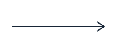
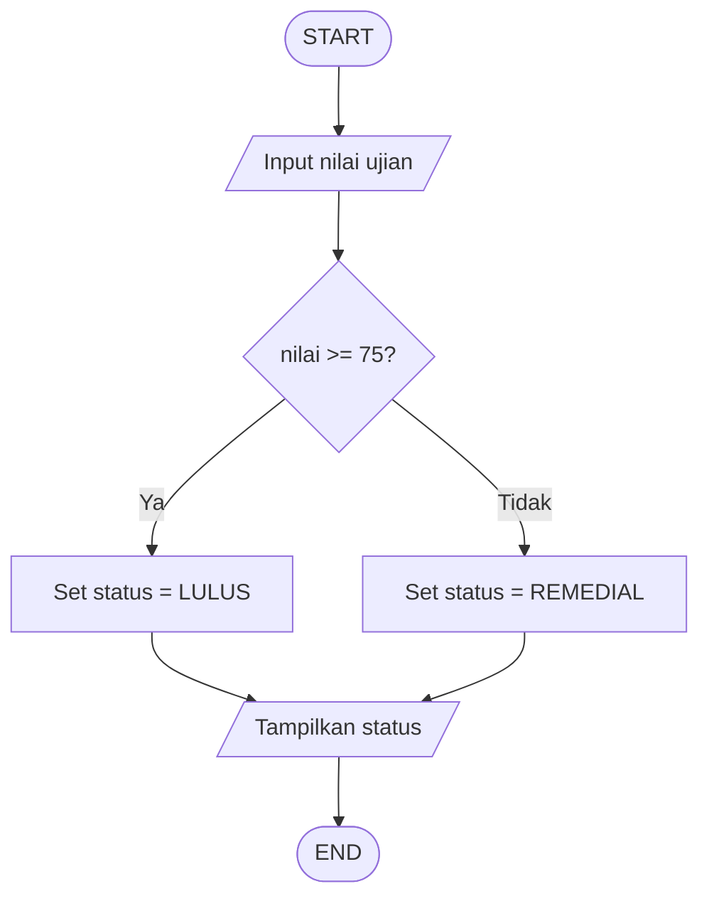
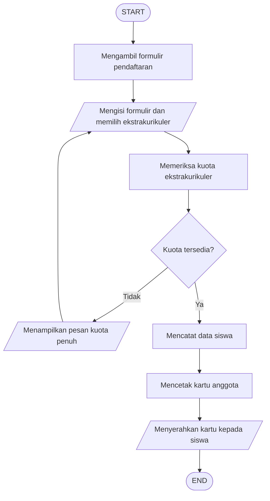
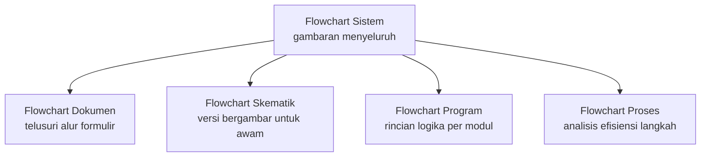
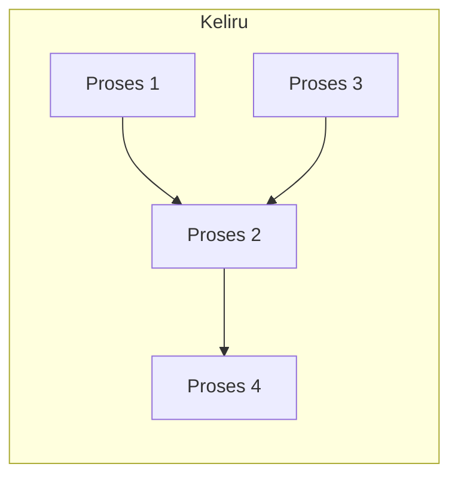

# Modul 1 — Dasar Flowchart dan Simbol Standar

**Mata pelajaran:** Analisis dan Desain Sistem Informasi (ADSI) — RPL
**Alat:** Kertas dan pensil, draw.io / diagrams.net, Mermaid (opsional)
**Studi kasus:** Prosedur pendaftaran ekstrakurikuler SMK
**Prasyarat:** Memahami konsep algoritma dasar (lihat Pengenalan Pemrograman Modul 2)

---

## 1. Tujuan Pembelajaran

Setelah mempelajari modul ini, kamu mampu:

1. Menjelaskan pengertian flowchart dan tujuan penggunaannya dalam analisis sistem.
2. Menyebutkan dan menerapkan 7 pedoman baku pembuatan flowchart.
3. Mengenali simbol flowchart standar ANSI/ISO beserta fungsinya.
4. Membedakan lima jenis flowchart dan kapan masing-masing dipakai.
5. Membaca flowchart yang sudah jadi dan menerjemahkannya menjadi narasi.
6. Membuat flowchart sederhana dari sebuah prosedur nyata.

---

## 2. Konsep Dasar

### Apa itu flowchart?

**Flowchart** (bagan alir) adalah **penggambaran secara grafik dari langkah-langkah dan urut-urutan prosedur** dalam suatu program atau sistem. Flowchart memakai simbol-simbol baku yang dihubungkan dengan garis panah untuk menunjukkan arah aliran.

Flowchart menjawab pertanyaan: **"Apa yang terjadi, dalam urutan seperti apa, dan apa yang menentukan percabangannya?"**

### Tujuan membuat flowchart

| Tujuan | Penjelasan |
| ------------------------ | ------------------------------------------------------------------------- |
| Menggambarkan tahapan | Memperlihatkan langkah penyelesaian masalah secara berurutan |
| Menyederhanakan rangkaian | Proses yang rumit dipecah jadi langkah kecil yang mudah dicerna |
| Menguraikan secara rinci | Setiap aktivitas tergambar jelas, tidak ada langkah yang tersembunyi |
| Alat komunikasi | Analis, programmer, dan pengguna bisa membaca dokumen yang sama |
| Dasar dokumentasi | Menjadi acuan saat sistem dikembangkan atau diperbaiki di masa depan |

Flowchart yang baik harus **sederhana, terurai, rapi, dan jelas**, serta memakai **simbol standar** supaya bisa dibaca siapa pun.

### Analogi

Flowchart seperti **peta jalan**. Kamu tidak perlu tahu merek aspalnya; kamu hanya perlu tahu dari mana mulai, belok ke mana saat ada persimpangan, dan di mana tujuan akhirnya.

### Istilah penting

Bentuk simbol mengikuti referensi *2-3-4-5-6- MATERi Flowchart dan_ADSI_TERSTRUKTUR.pdf*. Gambar pada tabel membantu mengenali bentuk, bukan menggantikan arti simbol.

| Istilah | Simbol / ilustrasi | Arti |
| --- | --- | --- |
| Simbol |  | Bentuk geometris baku yang mewakili satu jenis aktivitas |
| Arus / flow line |  | Garis panah yang menunjukkan urutan dan arah proses |
| Percabangan |  | Titik keputusan di mana alur terpecah berdasarkan kondisi |
| Konektor |  | Simbol penyambung alur pada halaman yang sama atau halaman berbeda |
| Terminal |  | Simbol penanda awal (START) dan akhir (END) sebuah alur |
| Proses |  | Aktivitas yang mengubah data atau melakukan pekerjaan |

---

## 3. Studi Kasus

SMK Nusantara membuka pendaftaran ekstrakurikuler. Prosedurnya:

1. Siswa mengambil formulir di ruang kesiswaan.
2. Siswa mengisi formulir dan memilih satu ekstrakurikuler.
3. Petugas memeriksa kuota ekstrakurikuler yang dipilih.
4. Jika kuota masih tersedia, data siswa dicatat dan kartu anggota dicetak.
5. Jika kuota penuh, siswa diminta memilih ekstrakurikuler lain.
6. Proses selesai setelah kartu anggota diterima siswa.

Prosedur ini akan kita ubah menjadi flowchart pada bagian praktik.

---

## 4. Persiapan

1. Siapkan kertas kosong dan pensil. **Selalu buat sketsa tangan dulu** sebelum menggambar digital — jauh lebih cepat saat merevisi.
2. Buka [draw.io](https://app.diagrams.net) di browser. Pilih **Create New Diagram** → kategori **Flowchart** → **Blank Diagram**.
3. Pada panel kiri, ketik `flowchart` di kotak **Search Shapes** supaya simbol baku muncul.
4. (Opsional) Jika ingin menulis diagram dalam bentuk kode, gunakan sintaks **Mermaid** di editor Markdown seperti VS Code atau GitHub.
5. Siapkan daftar langkah prosedur dalam bentuk teks terlebih dahulu. Flowchart yang baik selalu dimulai dari narasi yang jelas.

---

## 5. Materi dan Praktik

### 5.1 Tujuh pedoman membuat flowchart

Tujuh pedoman berikut adalah aturan baku yang wajib dipatuhi.

| No | Pedoman | Maksudnya |
| --- | --------------------------------------- | ----------------------------------------------------------------------------- |
| 1 | Digambar dari atas ke bawah, kiri ke kanan | Arah baca mengikuti kebiasaan membaca, supaya tidak membingungkan |
| 2 | Aktivitas didefinisikan dengan hati-hati | Satu simbol = satu aktivitas yang jelas batas awal dan akhirnya |
| 3 | Awal dan akhir aktivitas harus jelas | Gunakan simbol terminal `START` dan `END` |
| 4 | Deskripsi memakai kata kerja | Contoh: `MENGHITUNG PAJAK PENJUALAN`, bukan `PAJAK PENJUALAN` |
| 5 | Urutan aktivitas harus benar | Langkah tidak boleh melompat atau tertukar |
| 6 | Percabangan lintas halaman pakai konektor | Gunakan simbol konektor supaya alur tetap tersambung |
| 7 | Gunakan simbol standar ANSI/ISO | Supaya bisa dibaca oleh analis lain tanpa penjelasan tambahan |

**Penjelasan pedoman nomor 4.** Perhatikan perbedaan berikut:

| Keliru | Benar | Alasan |
| ------------------- | ---------------------------- | -------------------------------------------- |
| `Pajak` | `Menghitung pajak penjualan` | Menyebut objek saja, bukan aktivitas |
| `Data siswa` | `Menyimpan data siswa` | Tidak terlihat apa yang dikerjakan |
| `Error` | `Menampilkan pesan kesalahan` | Tidak jelas sistem melakukan apa |

Kata kerja membuat pembaca langsung tahu **apa yang dikerjakan sistem**, bukan sekadar objek apa yang terlibat.

### 5.2 Simbol flowchart standar

Simbol flowchart dibakukan oleh **ANSI** (American National Standards Institute) dan diadopsi **ISO**. Berikut simbol yang paling sering dipakai.

#### a. Simbol dasar (wajib hafal)

| Nama simbol | Bentuk | Fungsi |
| -------------------- | ------------------- | ------------------------------------------------------------- |
| <br>Terminal / Terminator | Oval / stadium | Menandai awal (`START`) dan akhir (`END`) alur |
| <br>Process | Persegi panjang | Aktivitas pengolahan, perhitungan, atau penugasan nilai |
| <br>Decision | Belah ketupat | Pengambilan keputusan dengan dua cabang atau lebih |
| <br>Input/Output | Jajar genjang | Pemasukan data atau penampilan hasil secara umum |
| <br>Flow line | Garis panah | Menunjukkan arah dan urutan aliran |
| <br>Connector | Lingkaran kecil | Penyambung alur di halaman yang sama |
| <br>Off-page connector | Segi lima / panah | Penyambung alur ke halaman yang berbeda |

#### b. Simbol input/output spesifik

| Nama simbol | Fungsi |
| ------------------ | ----------------------------------------------------------- |
| <br>Document | Keluaran berupa dokumen atau laporan tercetak |
| <br>Multi-document | Keluaran berupa beberapa dokumen sekaligus (rangkap) |
| <br>Manual Input | Masukan data melalui keyboard atau perangkat ketik |
| <br>Display | Keluaran yang ditampilkan di layar monitor |
| <br>Manual Operation | Pekerjaan yang dilakukan manusia, bukan komputer |

#### c. Simbol penyimpanan

| Nama simbol | Fungsi |
| ------------------- | ---------------------------------------------------------- |
| <br>Magnetic Disk | Penyimpanan di hard disk atau database |
| <br>Stored Data | Penyimpanan data secara umum |
| <br>Internal Storage | Penyimpanan di memori utama |
| <br>Manual File | Arsip atau berkas yang disimpan secara manual |

#### d. Simbol pemrosesan khusus

| Nama simbol | Fungsi |
| ------------------ | ------------------------------------------------------------------ |
| <br>Predefined Process | Memanggil subprogram, prosedur, atau modul yang sudah didefinisikan |
| <br>Preparation | Inisialisasi variabel atau pengaturan nilai awal perulangan |
| <br>Merge | Menggabungkan beberapa aliran menjadi satu |
| <br>Sort | Mengurutkan data berdasarkan kriteria tertentu |

**Catatan praktis.** Kamu tidak perlu menghafal semuanya. Kuasai dulu **tujuh simbol dasar** pada tabel (a) — itu sudah cukup untuk 90% kebutuhan. Simbol lain dipakai saat sistem benar-benar menuntutnya.

### 5.3 Membaca flowchart

Sebelum membuat, biasakan **membaca** flowchart. Perhatikan contoh berikut.



Cara membacanya baris per baris:

1. Alur dimulai dari simbol terminal `START`.
2. Sistem menerima masukan berupa nilai ujian — simbol jajar genjang menandakan input/output.
3. Sistem memeriksa kondisi `nilai >= 75?` — simbol belah ketupat menandakan percabangan.
4. Jika **Ya**, status diisi `LULUS`. Jika **Tidak**, status diisi `REMEDIAL`.
5. Kedua cabang **bertemu kembali** pada simbol penampilan status. Pertemuan cabang ini penting supaya alur tidak menggantung.
6. Alur berakhir di terminal `END`.

> **Aturan emas percabangan:** setiap cabang keputusan harus berujung — entah bertemu kembali dengan cabang lain, atau menuju terminal akhir. Cabang yang menggantung adalah tanda flowchart belum selesai.

### 5.4 Praktik: membuat flowchart pendaftaran ekstrakurikuler

#### a. Langkah 1 — tulis narasi dalam bentuk daftar

Ubah studi kasus menjadi daftar langkah pendek yang masing-masing memakai kata kerja:

1. Mengambil formulir pendaftaran
2. Mengisi formulir dan memilih ekstrakurikuler
3. Memeriksa kuota ekstrakurikuler
4. Mencatat data siswa
5. Mencetak kartu anggota
6. Menyerahkan kartu kepada siswa

#### b. Langkah 2 — tandai titik keputusan

Dari daftar di atas, hanya ada **satu** titik keputusan: *apakah kuota masih tersedia?* Titik inilah yang akan menjadi simbol belah ketupat.

#### c. Langkah 3 — gambar flowchart



Perhatikan tiga hal penting pada flowchart ini:

- **Semua deskripsi memakai kata kerja** sesuai pedoman nomor 4.
- **Cabang "Tidak" kembali ke langkah pengisian formulir**, membentuk perulangan. Siswa boleh memilih ulang sampai menemukan ekstrakurikuler yang kuotanya tersedia.
- **Arah gambar dari atas ke bawah** sesuai pedoman nomor 1.

#### d. Langkah 4 — uji dengan menelusuri alur

Uji flowchart dengan dua skenario:

| Skenario | Jalur yang dilalui | Hasil |
| ---------------------------------- | ----------------------------------------------- | ----------------- |
| Siswa memilih Futsal, kuota ada | A → B → C → D → E(Ya) → G → H → I → J | Kartu diterima |
| Siswa memilih Pramuka, kuota penuh | A → B → C → D → E(Tidak) → F → C → D → E(Ya) … | Memilih ulang |

Jika kedua skenario bisa ditelusuri tanpa buntu, flowchart sudah benar secara logika.

### 5.5 Lima jenis flowchart

Flowchart tidak hanya satu macam. Dalam analisis sistem dikenal **lima jenis**, masing-masing punya sudut pandang berbeda.

| No | Jenis flowchart | Fokus | Pembaca utama |
| --- | ---------------------------- | ------------------------------------------------- | ------------------------- |
| 1 | Flowchart Sistem | Alur kerja sistem secara keseluruhan | Analis sistem, manajemen |
| 2 | Flowchart Dokumen (Paperwork) | Alur perjalanan form/laporan antar bagian | Bagian administrasi |
| 3 | Flowchart Skematik | Alur sistem dengan gambar perangkat nyata | Pengguna awam |
| 4 | Flowchart Program | Langkah rinci logika program | Programmer |
| 5 | Flowchart Proses | Analisis efisiensi langkah kerja | Rekayasa industri, QA |

Hubungan antarjenis dapat digambarkan sebagai berikut:



**Flowchart Sistem adalah induknya.** Dari flowchart sistem, kita menurunkan flowchart program untuk programmer, flowchart dokumen untuk bagian administrasi, dan flowchart skematik untuk presentasi ke pengguna awam.

Kelima jenis ini dibahas tuntas pada **Modul 2** sampai **Modul 4**.

### 5.6 Kesalahan menggambar yang sering terjadi

#### a. Simbol tidak sesuai fungsinya

| Keliru | Benar |
| --------------------------------------- | ----------------------------------------- |
| Memakai persegi panjang untuk keputusan | Keputusan selalu memakai belah ketupat |
| Memakai belah ketupat untuk input | Input/output memakai jajar genjang |
| Alur dimulai langsung dari proses | Alur selalu dimulai dari simbol terminal |

#### b. Percabangan tidak diberi label

Setiap garis yang keluar dari simbol keputusan **wajib diberi label** (`Ya`/`Tidak`, `Benar`/`Salah`, atau nilai kondisinya). Tanpa label, pembaca tidak tahu cabang mana yang mana.

#### c. Arah panah tidak konsisten

Bandingkan dua gambar berikut.



Pada contoh keliru, `Proses 3` muncul tiba-tiba tanpa diketahui dari mana asalnya. Setiap simbol selain terminal awal **harus punya minimal satu panah masuk**.

---

## 6. Rangkuman

- **Flowchart** adalah penggambaran grafis langkah dan urutan prosedur memakai simbol baku.
- Flowchart yang baik bersifat **sederhana, terurai, rapi, dan jelas**.
- Ada **7 pedoman baku**: arah atas-bawah kiri-kanan, aktivitas terdefinisi, awal-akhir jelas, deskripsi kata kerja, urutan benar, konektor untuk lintas halaman, dan simbol standar ANSI/ISO.
- Tujuh simbol dasar yang wajib dikuasai: **terminal, process, decision, input/output, flow line, connector, off-page connector**.
- Setiap cabang keputusan **wajib diberi label** dan harus berujung, tidak boleh menggantung.
- Ada **5 jenis flowchart**: Sistem, Dokumen, Skematik, Program, dan Proses — masing-masing untuk pembaca yang berbeda.

---

## 7. Latihan

1. Tuliskan ulang deskripsi berikut supaya sesuai pedoman nomor 4 (memakai kata kerja): `Total belanja`, `Stok barang`, `Laporan bulanan`, `Validasi`.
2. Gambarkan flowchart untuk prosedur **meminjam buku di perpustakaan sekolah**, dengan ketentuan: anggota maksimal meminjam 3 buku; jika sudah 3, peminjaman ditolak.
3. Gambarkan flowchart untuk **menghitung nilai akhir** dengan rumus `NA = (0.3 × UH) + (0.3 × UTS) + (0.4 × UAS)`, kemudian tampilkan predikat `A` jika NA ≥ 90, `B` jika NA ≥ 80, `C` jika NA ≥ 70, selain itu `D`.
4. Perhatikan flowchart berikut, lalu tuliskan narasinya dalam bentuk paragraf:

   ```mermaid
   flowchart TD
       A([START]) --> B[/Input jumlah barang/]
       B --> C{jumlah > 10?}
       C -->|Ya| D[diskon = 10%]
       C -->|Tidak| E[diskon = 0%]
       D --> F[Menghitung total bayar]
       E --> F
       F --> G[/Menampilkan total bayar/]
       G --> H([END])
   ```

5. Temukan **tiga kesalahan** pada deskripsi flowchart berikut, lalu perbaiki: *"Mulai dari proses hitung gaji. Lalu ada kotak persegi panjang bertuliskan 'gaji > 5 juta?' dengan dua garis keluar tanpa keterangan. Salah satu garis tidak terhubung ke mana-mana."*

---

## 8. Kuis

1. Simbol belah ketupat dalam flowchart digunakan untuk ….
   a. Menyimpan data  b. Mengambil keputusan  c. Mencetak dokumen  d. Memulai alur
2. Berikut yang **bukan** termasuk tujuh pedoman pembuatan flowchart adalah ….
   a. Digambar dari atas ke bawah  b. Deskripsi memakai kata kerja  c. Memakai warna cerah  d. Memakai simbol standar
3. Deskripsi proses yang benar menurut pedoman adalah ….
   a. `Pajak penjualan`  b. `Menghitung pajak penjualan`  c. `Pajak`  d. `PPN 11%`
4. Simbol yang dipakai untuk menyambung alur ke halaman lain adalah ….
   a. Connector  b. Off-page connector  c. Merge  d. Preparation
5. Jenis flowchart yang menjadi induk bagi jenis flowchart lainnya adalah ….
   a. Flowchart Program  b. Flowchart Dokumen  c. Flowchart Sistem  d. Flowchart Proses
6. Lembaga yang membakukan simbol flowchart adalah ….
   a. IEEE dan W3C  b. ANSI dan ISO  c. ACM dan IETF  d. ITU dan ISO

---

## 9. Kesalahan Umum

| Kesalahan | Akibat | Perbaikan |
| ---------------------------------------------- | ----------------------------------------------------- | --------------------------------------------------------------- |
| Memakai kata benda sebagai deskripsi proses | Pembaca tidak tahu sistem mengerjakan apa | Awali dengan kata kerja: `Menghitung …`, `Menyimpan …` |
| Cabang keputusan tidak diberi label | Pembaca menebak-nebak cabang mana yang benar | Beri label `Ya`/`Tidak` pada setiap garis keluar |
| Satu simbol memuat banyak aktivitas sekaligus | Flowchart jadi tidak rinci dan sulit diterjemahkan | Pecah menjadi beberapa simbol proses |
| Alur tidak punya terminal awal/akhir | Tidak jelas kapan prosedur mulai dan selesai | Selalu mulai dengan `START` dan akhiri dengan `END` |
| Garis panah saling menyilang berantakan | Flowchart sulit dibaca | Atur tata letak ulang, atau gunakan connector |
| Cabang keputusan menggantung | Logika tidak lengkap, sistem bisa macet | Pastikan semua cabang bertemu kembali atau menuju terminal |
| Memakai simbol yang tidak baku | Analis lain tidak bisa membaca diagram | Patuhi simbol ANSI/ISO |
| Langsung menggambar tanpa menulis narasi dulu | Sering revisi, alur tidak runtut | Tulis daftar langkah bernomor terlebih dahulu |
