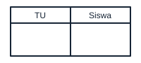
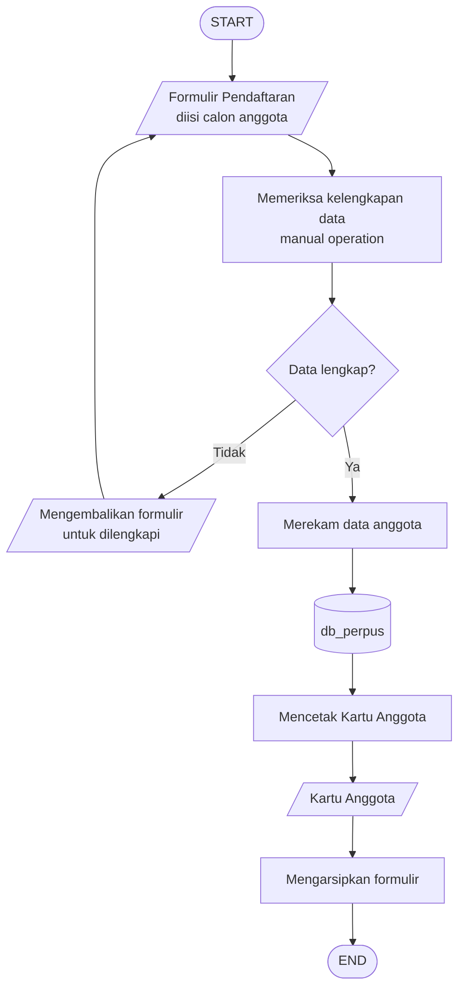
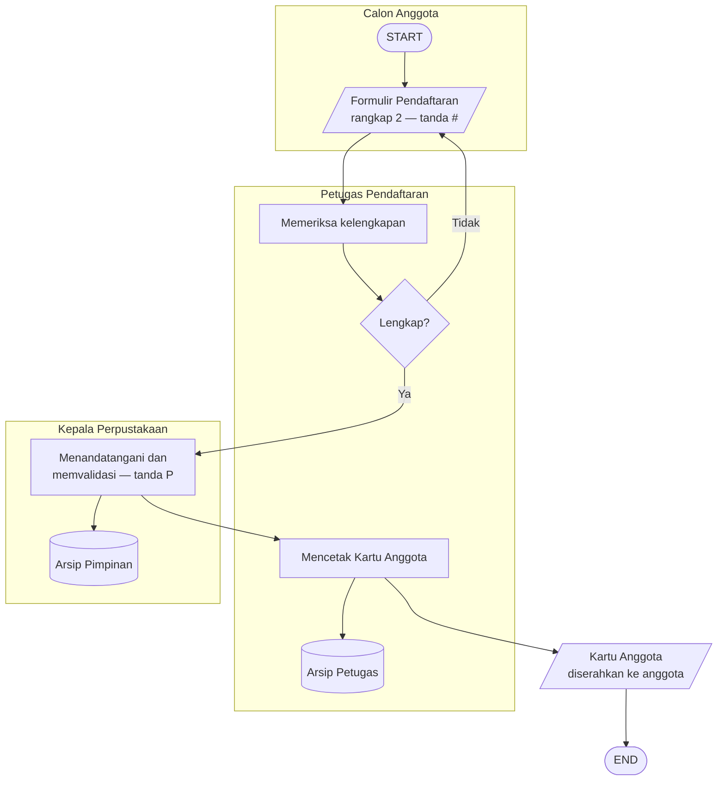
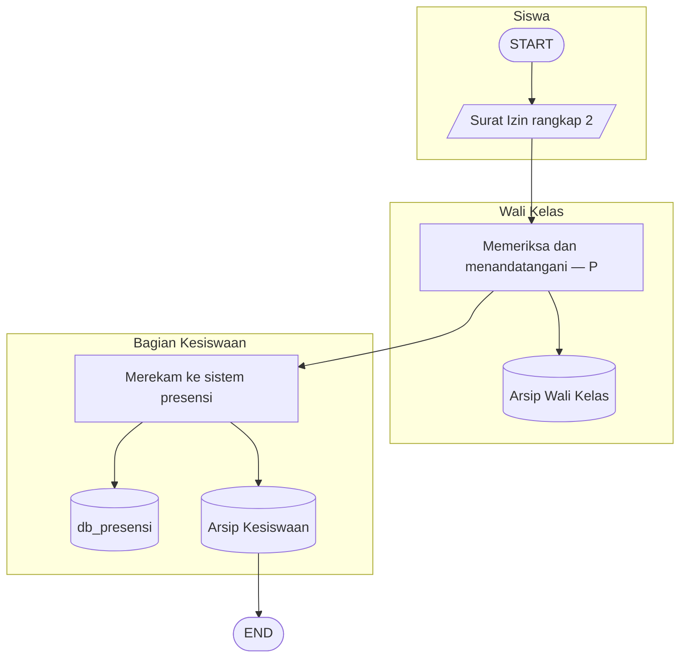

# Modul 2 — Flowchart Sistem dan Flowchart Dokumen

**Mata pelajaran:** Analisis dan Desain Sistem Informasi (ADSI) — RPL
**Alat:** draw.io / diagrams.net, Mermaid (opsional)
**Studi kasus:** Pendaftaran kartu anggota perpustakaan sekolah
**Prasyarat:** Modul 1 — Dasar Flowchart dan Simbol Standar

---

## 1. Tujuan Pembelajaran

Setelah mempelajari modul ini, kamu mampu:

1. Menjelaskan pengertian dan fungsi Flowchart Sistem.
2. Membedakan proses *online* dan *offline* dalam Flowchart Sistem.
3. Menjelaskan pengertian dan fungsi Flowchart Dokumen (Paperwork Flowchart).
4. Membaca notasi khusus pada Flowchart Dokumen seperti tanda `#` dan `P`.
5. Membuat Flowchart Sistem dari deskripsi prosedur nyata.
6. Membuat Flowchart Dokumen lengkap dengan pembagian kolom per bagian.

---

## 2. Konsep Dasar

### Flowchart Sistem (System Flowchart)

**Flowchart Sistem** adalah bagan yang menunjukkan **arus pekerjaan secara keseluruhan dari sebuah sistem**. Bagan ini menjelaskan urut-urutan prosedur yang ada di dalam sistem, termasuk **data apa yang mengalir** dan **proses apa yang mengolahnya**.

Yang perlu dipahami:

- Flowchart Sistem menggambarkan **urutan prosedur**, bukan langkah pemecahan masalah.
- Flowchart Sistem **bukan** alat untuk merinci logika program. Itu tugas Flowchart Program (Modul 4).
- Proses dalam Flowchart Sistem bisa berupa **proses komputer** maupun **proses manual**.

### Online dan offline

Flowchart Sistem mengenal dua jenis pemrosesan:

| Jenis | Pengertian | Contoh perangkat |
| ----------- | --------------------------------------------------------- | ----------------------------------------- |
| **Online** | Proses terhubung langsung ke komputer / sistem terpusat | Aplikasi web, input lewat terminal kasir |
| **Offline** | Proses tidak terhubung ke komputer, berdiri sendiri | Mesin tik, *cash register*, kalkulator |

Pembedaan ini penting karena saat merancang sistem baru, bagian **offline** biasanya menjadi kandidat utama untuk **diotomatiskan**.

### Flowchart Dokumen (Paperwork Flowchart)

**Flowchart Dokumen** — disebut juga **Flowchart Formulir** atau *Paperwork Flowchart* — adalah bagan yang **menelusuri alur perjalanan formulir dan laporan**, termasuk tembusannya, dari satu bagian ke bagian lain dalam organisasi.

Fokusnya berbeda dengan Flowchart Sistem:

| Aspek | Flowchart Sistem | Flowchart Dokumen |
| ---------------- | ---------------------------------- | ----------------------------------------- |
| Yang ditelusuri | Data dan proses | Formulir/laporan fisik dan tembusannya |
| Pertanyaan kunci | "Proses apa yang terjadi?" | "Dokumen ini berpindah ke mana saja?" |
| Pembaca utama | Analis sistem, manajemen | Bagian administrasi, auditor |
| Tata letak | Mengalir dari atas ke bawah | Dibagi kolom berdasarkan bagian/unit |

### Istilah penting

Gambar mengikuti bentuk pada modul referensi. Untuk konsep tanpa simbol baku, gambar merupakan **ilustrasi/contoh**, bukan notasi standar baru.

| Istilah | Simbol / ilustrasi | Arti |
| --- | --- | --- |
| Tembusan |  | Salinan dokumen yang diberikan ke bagian lain (rangkap 2, 3, dst) |
| Unit / bagian |  | Pihak dalam organisasi yang menangani dokumen |
| Arsip |  | Tempat penyimpanan akhir dokumen |
| Validasi |  | Pemeriksaan kebenaran dan kelengkapan isi dokumen |
| Swimlane |  | Kolom pembagi yang menunjukkan siapa mengerjakan apa |

---

## 3. Studi Kasus

Perpustakaan SMK Nusantara melayani pembuatan **kartu anggota**. Prosedurnya melibatkan tiga pihak: **Calon Anggota**, **Petugas Pendaftaran**, dan **Kepala Perpustakaan**.

Alur dokumennya:

1. Calon anggota mengisi **Formulir Pendaftaran** rangkap 2.
2. Formulir diserahkan ke Petugas Pendaftaran.
3. Petugas memeriksa kelengkapan data. Jika tidak lengkap, formulir dikembalikan untuk dilengkapi.
4. Formulir yang lengkap diserahkan ke Kepala Perpustakaan untuk **ditandatangani dan divalidasi**.
5. Formulir rangkap 1 diarsipkan oleh Kepala Perpustakaan.
6. Formulir rangkap 2 kembali ke Petugas sebagai dasar **mencetak Kartu Anggota**.
7. Kartu Anggota diserahkan ke anggota; formulir rangkap 2 diarsipkan Petugas.

Dalam notasi Flowchart Dokumen, dua tanda berikut dipakai:

| Tanda | Arti |
| ----- | ------------------------------------------------- |
| `#` | Memasukkan data calon anggota |
| `P` | Menandatangani dan memvalidasi data |

---

## 4. Persiapan

1. Buka draw.io, buat diagram kosong.
2. Aktifkan **grid** lewat menu **View → Grid** supaya penempatan simbol rapi.
3. Untuk Flowchart Dokumen, siapkan pembagian kolom terlebih dahulu. Di draw.io, cari shape **Pool** atau **Horizontal Pool** di kotak pencarian, lalu bagi menjadi kolom sejumlah bagian yang terlibat.
4. Siapkan daftar **semua dokumen** yang terlibat beserta jumlah rangkapnya. Ini akan menghemat banyak waktu revisi.
5. Siapkan daftar **semua bagian/unit** yang menyentuh dokumen tersebut.

---

## 5. Materi dan Praktik

### 5.1 Simbol khas Flowchart Sistem

Selain tujuh simbol dasar dari Modul 1, Flowchart Sistem banyak memakai simbol berikut.

| Simbol | Fungsi dalam Flowchart Sistem |
| ----------------- | --------------------------------------------------------- |
|  Document | Dokumen atau laporan tercetak |
|  Manual Operation | Pekerjaan yang dilakukan manusia tanpa komputer |
|  Manual Input | Pemasukan data lewat keyboard |
|  Magnetic Disk | Penyimpanan data di database atau hard disk |
|  Display | Keluaran yang ditampilkan di layar |
|  Manual File | Arsip dokumen fisik (map, lemari arsip) |
|  Offline Storage | Penyimpanan data di luar sistem komputer |

Perbedaan penting yang sering tertukar:

| Simbol | Dipakai saat | Contoh |
| ------------------ | ------------------------------------------------ | --------------------------------- |
| `Process` | Komputer yang mengolah | Menghitung total tagihan |
| `Manual Operation` | Manusia yang mengerjakan | Memeriksa kelengkapan berkas |
| `Manual Input` | Manusia memasukkan data ke komputer | Mengetik data siswa ke aplikasi |

### 5.2 Praktik: Flowchart Sistem pendaftaran anggota perpustakaan

#### a. Langkah 1 — identifikasi proses dan data

| Proses | Jenis | Data masuk | Data keluar |
| ----------------------------- | ---------------- | ------------------------ | ------------------------- |
| Mengisi formulir | Manual | — | Formulir terisi |
| Memeriksa kelengkapan data | Manual Operation | Formulir terisi | Formulir tervalidasi |
| Merekam data anggota | Komputer | Formulir tervalidasi | Record di `db_perpus` |
| Mencetak kartu anggota | Komputer | Record di `db_perpus` | Kartu Anggota |

#### b. Langkah 2 — gambar Flowchart Sistem

Perhatikan:

- Simbol **silinder** `db_perpus` mewakili penyimpanan di database — ini bagian **online**.
- Proses *Memeriksa kelengkapan data* adalah **manual operation**, dikerjakan petugas, bukan komputer. Dalam perancangan sistem baru, langkah ini adalah kandidat otomatisasi (misalnya validasi form di aplikasi).
- Cabang `Tidak` kembali ke pengisian formulir — membentuk perulangan perbaikan.

#### c. Langkah 3 — tandai bagian online dan offline

| Langkah | Online/Offline | Alasan |
| ----------------------------- | -------------- | -------------------------------------------- |
| Mengisi formulir kertas | Offline | Tidak terhubung komputer |
| Memeriksa kelengkapan data | Offline | Dikerjakan manual oleh petugas |
| Merekam data anggota | Online | Data masuk ke database |
| Mencetak kartu anggota | Online | Diproses sistem dan dicetak printer |

Dari tabel ini terlihat bahwa **dua langkah awal masih offline**. Saran perbaikan sistem: ubah formulir kertas menjadi **formulir web** sehingga validasi kelengkapan dapat dilakukan otomatis.

### 5.3 Membaca Flowchart Dokumen

Flowchart Dokumen dibaca **per kolom**. Setiap kolom mewakili satu bagian. Garis panah yang menyeberangi kolom berarti **dokumen berpindah tangan**.

Contoh sederhana alur dokumen tiga bagian:

Cara membacanya:

1. **Kolom Calon Anggota.** Formulir rangkap 2 diisi, ditandai `#` yang berarti *memasukkan data calon anggota*.
2. **Kolom Petugas Pendaftaran.** Petugas memeriksa kelengkapan. Jika tidak lengkap, formulir dikembalikan — perhatikan panah yang kembali menyeberang ke kolom kiri.
3. **Kolom Kepala Perpustakaan.** Formulir ditandatangani dan divalidasi, ditandai `P`. Rangkap 1 masuk Arsip Pimpinan.
4. Rangkap 2 kembali ke Petugas sebagai dasar mencetak Kartu Anggota, lalu diarsipkan di Arsip Petugas.
5. Kartu Anggota diserahkan ke anggota — alur selesai.

> **Kunci membaca Flowchart Dokumen:** ikuti satu lembar dokumen dari awal sampai akhir. Tanyakan: *lembar ini sekarang ada di tangan siapa, dan ke mana berikutnya?*

### 5.4 Praktik: menelusuri setiap rangkap dokumen

Latih kemampuan membaca dengan membuat **tabel penelusuran**. Ini teknik yang dipakai auditor.

| Dokumen | Rangkap | Dibuat oleh | Melalui | Berakhir di |
| ---------------------------- | ------- | ---------------- | ------------------------------ | ---------------------- |
| Formulir Pendaftaran | 1 | Calon Anggota | Petugas → Kepala Perpustakaan | Arsip Pimpinan |
| Formulir Pendaftaran | 2 | Calon Anggota | Petugas → Kepala → Petugas | Arsip Petugas |
| Kartu Anggota | 1 | Petugas | — | Diterima anggota |

Tabel ini membantumu menemukan masalah sejak awal. Contohnya:

- Jika ada dokumen yang **tidak punya tempat berakhir**, berarti alur belum lengkap.
- Jika ada rangkap yang **tidak pernah dipakai siapa pun**, berarti rangkap itu mubazir dan bisa dihapus — ini temuan efisiensi.

### 5.5 Kapan memakai jenis yang mana

| Situasi | Gunakan |
| -------------------------------------------------------------- | ------------------- |
| Menjelaskan sistem baru ke manajemen | Flowchart Sistem |
| Menemukan tembusan dokumen yang mubazir | Flowchart Dokumen |
| Menentukan proses mana yang masih manual dan perlu otomatisasi | Flowchart Sistem |
| Audit kepatuhan prosedur administrasi | Flowchart Dokumen |
| Mendokumentasikan aliran data antar modul aplikasi | Flowchart Sistem |
| Memetakan tanggung jawab setiap bagian atas dokumen | Flowchart Dokumen |

Pada praktiknya, analis sistem sering membuat **keduanya**: Flowchart Sistem untuk gambaran besar, lalu Flowchart Dokumen untuk memeriksa detail administrasi.

### 5.6 Studi kasus tambahan: alur surat izin tidak masuk

Latihan singkat agar polanya makin melekat. Prosedurnya:

1. Siswa membuat **Surat Izin** rangkap 2 dan menyerahkan ke Wali Kelas.
2. Wali Kelas memeriksa dan menandatangani (`P`).
3. Rangkap 1 diarsipkan Wali Kelas, rangkap 2 diteruskan ke Bagian Kesiswaan.
4. Bagian Kesiswaan merekam ke sistem presensi, lalu mengarsipkan rangkap 2.

Perhatikan bahwa Bagian Kesiswaan melakukan **dua hal sekaligus**: merekam ke database (online) dan mengarsipkan lembar fisik (offline). Inilah bentuk nyata sistem **semi-terotomatisasi** yang banyak ditemui di sekolah.

---

## 6. Rangkuman

- **Flowchart Sistem** menggambarkan arus pekerjaan sistem secara keseluruhan: data apa yang mengalir dan proses apa yang mengolahnya.
- Flowchart Sistem **bukan** alat untuk merinci langkah pemecahan masalah — itu tugas Flowchart Program.
- Proses dibedakan menjadi **online** (terhubung komputer) dan **offline** (mesin tik, cash register, kalkulator). Bagian offline adalah kandidat otomatisasi.
- **Flowchart Dokumen** menelusuri perjalanan formulir dan tembusannya antar bagian organisasi.
- Flowchart Dokumen dibagi **kolom per bagian**; panah yang menyeberang kolom berarti dokumen berpindah tangan.
- Notasi `#` berarti *memasukkan data*, `P` berarti *menandatangani dan memvalidasi*.
- **Tabel penelusuran dokumen** adalah teknik praktis untuk menemukan dokumen yang menggantung atau rangkap yang mubazir.

---

## 7. Latihan

1. Jelaskan dengan kalimatmu sendiri tiga perbedaan utama Flowchart Sistem dan Flowchart Dokumen.
2. Buat **Flowchart Sistem** untuk prosedur **pembayaran SPP** berikut: siswa membayar di loket; petugas memasukkan data pembayaran ke aplikasi; sistem menyimpan ke database dan mencetak kuitansi rangkap 2; satu untuk siswa, satu diarsipkan.
3. Dari soal nomor 2, buat juga **Flowchart Dokumen**-nya dengan kolom: Siswa, Petugas Loket, Bendahara.
4. Buat **tabel penelusuran dokumen** untuk soal nomor 3.
5. Pada studi kasus kartu anggota perpustakaan, identifikasi **dua langkah offline** yang menurutmu paling layak diotomatiskan. Jelaskan alasanmu dan apa manfaatnya.
6. Sebuah sekolah memakai *cash register* untuk mencatat penjualan kantin. Apakah ini termasuk proses online atau offline? Jelaskan, lalu usulkan perbaikannya.

---

## 8. Kuis

1. Flowchart yang menggambarkan arus pekerjaan sistem secara keseluruhan disebut ….
   a. Flowchart Program  b. Flowchart Sistem  c. Flowchart Proses  d. Flowchart Skematik
2. Mesin tik, cash register, dan kalkulator termasuk contoh pemrosesan ….
   a. Online  b. Real time  c. Offline  d. Batch
3. Flowchart yang menelusuri perjalanan formulir dan tembusannya disebut ….
   a. Flowchart Dokumen  b. Flowchart Sistem  c. Flowchart Data  d. Flowchart Arsip
4. Pada Flowchart Dokumen studi kasus perpustakaan, tanda `P` berarti ….
   a. Pencetakan kartu  b. Pengarsipan  c. Menandatangani dan memvalidasi data  d. Pengembalian formulir
5. Simbol yang tepat untuk pekerjaan "memeriksa kelengkapan berkas oleh petugas" adalah ….
   a. Process  b. Manual Operation  c. Manual Input  d. Display
6. Kegunaan utama tabel penelusuran dokumen adalah ….
   a. Menghitung biaya cetak  b. Menemukan dokumen menggantung dan rangkap mubazir  c. Menentukan warna formulir  d. Mengukur kecepatan server

---

## 9. Kesalahan Umum

| Kesalahan | Akibat | Perbaikan |
| ---------------------------------------------------------- | ------------------------------------------------------- | --------------------------------------------------------------- |
| Memakai Flowchart Sistem untuk merinci logika program | Diagram jadi terlalu detail dan sulit dibaca manajemen | Pakai Flowchart Program (Modul 4) untuk rincian logika |
| Tidak membedakan proses manual dan proses komputer | Peluang otomatisasi tidak terlihat | Gunakan simbol Manual Operation untuk pekerjaan manusia |
| Flowchart Dokumen tidak dibagi kolom per bagian | Tidak terlihat siapa bertanggung jawab atas dokumen | Gunakan swimlane / pool untuk tiap bagian |
| Tembusan dokumen tidak digambar | Audit tidak bisa menelusuri salinan dokumen | Gambar setiap rangkap secara terpisah dan beri nomor |
| Dokumen tidak punya titik akhir (arsip atau diserahkan) | Alur dokumen menggantung | Pastikan setiap rangkap berakhir di arsip atau diterima pihak |
| Menggambar handler dokumen sebagai bagian tersendiri | Diagram penuh simbol yang tidak bermakna | Kurir/pengantar tidak perlu digambar; fokus pada unit pengolah |
| Menyamakan "merekam ke database" dengan "mengarsipkan" | Satu proses dianggap sudah mencakup keduanya | Pisahkan: database untuk data, arsip untuk dokumen fisik |
