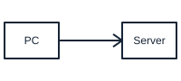
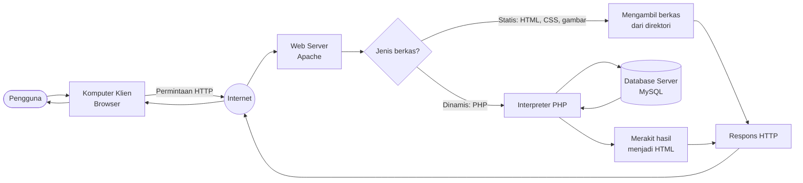
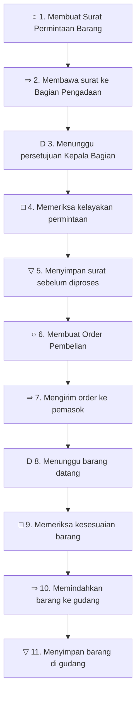

# Modul 3 — Flowchart Skematik dan Flowchart Proses

**Mata pelajaran:** Analisis dan Desain Sistem Informasi (ADSI) — RPL
**Alat:** draw.io / diagrams.net (dengan shape library AWS/Networking), Mermaid (opsional)
**Studi kasus:** Struktur pembacaan web server dan prosedur pembelian barang
**Prasyarat:** Modul 1 dan Modul 2

---

## 1. Tujuan Pembelajaran

Setelah mempelajari modul ini, kamu mampu:

1. Menjelaskan pengertian Flowchart Skematik dan tujuan penggunaannya.
2. Menyebutkan kelebihan dan kekurangan Flowchart Skematik.
3. Membuat Flowchart Skematik untuk menjelaskan arsitektur sistem kepada pengguna awam.
4. Menjelaskan pengertian Flowchart Proses dan asalnya dari rekayasa industri.
5. Menggunakan lima simbol khusus Flowchart Proses (ASME) dengan tepat.
6. Menganalisis efisiensi sebuah prosedur menggunakan Flowchart Proses.

---

## 2. Konsep Dasar

### Flowchart Skematik (Schematic Flowchart)

**Flowchart Skematik** mirip dengan Flowchart Sistem — sama-sama menggambarkan prosedur sistem secara keseluruhan. Bedanya, Flowchart Skematik **tidak hanya memakai simbol baku**, tetapi juga **gambar komputer, peripheral, form, dan perangkat lain** yang menyerupai bentuk aslinya.

Tujuannya satu: **supaya orang yang tidak paham simbol flowchart tetap bisa mengerti**.

| Aspek | Flowchart Sistem | Flowchart Skematik |
| ---------------- | -------------------------- | ------------------------------------- |
| Bentuk simbol | Simbol geometris baku | Gambar perangkat yang menyerupai asli |
| Pembaca sasaran | Analis dan programmer | Manajemen, klien, pengguna awam |
| Waktu pembuatan | Relatif cepat | Lama, butuh keahlian menggambar |
| Kepadatan info | Tinggi | Lebih rendah, lebih visual |

#### Kelebihan dan kekurangan

| Kelebihan | Kekurangan |
| --------------------------------------------------------- | ---------------------------------------------------------- |
| Mudah dimengerti orang awam tanpa pelatihan simbol | Butuh waktu lama untuk menggambarnya |
| Sangat efektif untuk presentasi dan proposal | Memerlukan keahlian menggambar atau aset ikon |
| Memperlihatkan perangkat fisik yang terlibat | Sulit menampung prosedur yang sangat rinci |
| Membantu menyamakan persepsi antara tim IT dan pengguna | Perlu digambar ulang jika perangkat berubah |

### Flowchart Proses (Process Flowchart)

**Flowchart Proses** berasal dari **teknik rekayasa industri** (*industrial engineering*). Fungsinya bukan menggambarkan logika sistem, melainkan **menganalisis efisiensi setiap langkah dalam sebuah prosedur**.

Pertanyaan yang dijawab Flowchart Proses:

- Langkah mana yang sebenarnya **memberi nilai tambah**?
- Berapa banyak waktu yang habis untuk **perpindahan** dan **menunggu**?
- Langkah mana yang bisa **dihapus, digabung, atau disederhanakan**?

### Istilah penting

Gambar mengikuti bentuk pada modul referensi. Untuk konsep tanpa simbol baku, gambar merupakan **ilustrasi/contoh**, bukan notasi standar baru.

| Istilah | Simbol / ilustrasi | Arti |
| --- | --- | --- |
| Peripheral |  | Perangkat pendukung komputer: printer, scanner, monitor |
| Arsitektur sistem |  | Susunan komponen sistem dan hubungan antarkomponennya |
| ASME |  | *American Society of Mechanical Engineers*, pembaku simbol proses |
| Nilai tambah |  | Langkah yang benar-benar mengubah/menambah manfaat pada objek |
| Bottleneck |  | Titik dalam proses yang menghambat keseluruhan alur |

---

## 3. Studi Kasus

### Studi kasus A — Struktur pembacaan web server

Saat kamu mengetik alamat sebuah situs di browser, terjadi rangkaian proses berikut:

1. Pengguna mengetik URL di browser pada komputer klien.
2. Browser mengirim permintaan HTTP melalui jaringan internet.
3. Web server menerima permintaan dan memeriksa jenis berkas yang diminta.
4. Jika berkas statis (HTML, CSS, gambar), web server langsung mengirimkannya.
5. Jika berkas dinamis (PHP), web server meneruskan ke interpreter PHP.
6. Interpreter PHP mengambil data dari database bila diperlukan.
7. Hasil dirakit menjadi HTML dan dikirim balik ke browser.
8. Browser menampilkan halaman kepada pengguna.

Materi ini akan dijelaskan ke **kepala sekolah yang bukan orang IT**, sehingga Flowchart Skematik adalah pilihan tepat.

### Studi kasus B — Sistem Pembelian barang

Bagian Pengadaan SMK Nusantara menjalankan prosedur pembelian:

1. Bagian yang membutuhkan membuat Surat Permintaan Barang.
2. Surat dibawa ke Bagian Pengadaan (lintas gedung).
3. Surat menunggu persetujuan Kepala Bagian Pengadaan.
4. Kepala Bagian memeriksa kelayakan permintaan.
5. Surat yang disetujui disimpan sementara sebelum diproses.
6. Petugas membuat Order Pembelian ke pemasok.
7. Barang datang, diperiksa kesesuaiannya dengan order.
8. Barang disimpan di gudang.

Prosedur ini akan dianalisis efisiensinya memakai Flowchart Proses.

---

## 4. Persiapan

1. Buka draw.io. Untuk Flowchart Skematik, klik **More Shapes** di bagian bawah panel kiri, lalu aktifkan kategori **Networking** dan **Cisco** agar tersedia ikon server, komputer, dan database.
2. Siapkan daftar **perangkat fisik** yang terlibat dalam sistem beserta perannya.
3. Untuk Flowchart Proses, siapkan **tabel langkah** berisi kolom: nomor, uraian kegiatan, jenis simbol, jarak (meter), dan waktu (menit).
4. Jika memungkinkan, lakukan **observasi langsung** terhadap prosedur yang dianalisis. Data waktu dan jarak yang nyata membuat analisis jauh lebih bermakna.

---

## 5. Materi dan Praktik

### 5.1 Praktik: Flowchart Skematik struktur pembacaan web server

#### a. Langkah 1 — daftar perangkat yang terlibat

| Perangkat | Peran dalam sistem | Ikon yang dipakai |
| ------------------ | -------------------------------------------------- | ----------------------- |
| Komputer klien | Tempat pengguna mengetik alamat situs | Gambar PC/laptop |
| Jaringan internet | Media pengantar permintaan dan jawaban | Gambar awan |
| Web server | Menerima dan melayani permintaan | Gambar rak server |
| Interpreter PHP | Menerjemahkan berkas PHP menjadi HTML | Gambar gir / modul |
| Database server | Menyimpan data yang dibutuhkan halaman | Gambar silinder/drum |

#### b. Langkah 2 — gambar alurnya

#### c. Langkah 3 — beri penjelasan naratif pendampingnya

Flowchart Skematik **selalu disertai narasi**, karena pembacanya bukan orang teknis. Contoh narasi untuk diagram di atas:

> Ketika pengguna mengetik alamat situs sekolah, komputer pengguna mengirim permintaan melalui internet menuju **web server** sekolah. Web server memeriksa berkas apa yang diminta. Jika yang diminta berkas biasa seperti gambar atau tampilan halaman, server langsung mengirimkannya kembali. Namun jika halaman memerlukan data — misalnya daftar nilai siswa — server meneruskan permintaan ke **program PHP**, yang kemudian mengambil data dari **database**. Setelah data lengkap, hasilnya dirakit menjadi halaman web utuh dan dikirim balik agar tampil di layar pengguna.

Perhatikan bahwa narasi **tidak memakai istilah teknis tanpa penjelasan**. Kata "HTTP" diganti "permintaan", "query" diganti "mengambil data".

#### d. Langkah 4 — ganti simbol dengan ikon di draw.io

Dalam versi final yang dipresentasikan, ganti kotak persegi menjadi ikon nyata:

| Simbol baku di diagram | Ganti menjadi ikon |
| ---------------------- | ------------------------- |
| Kotak `Komputer Klien` | Gambar laptop/PC |
| Lingkaran `Internet` | Gambar awan |
| Kotak `Web Server` | Gambar rak server |
| Silinder `Database` | Gambar drum database |
| Belah ketupat | Tetap belah ketupat, atau ganti teks pertanyaan |

Inilah yang membedakan Flowchart Skematik dari Flowchart Sistem: **bentuk visual lebih diutamakan daripada kepadatan informasi**.

### 5.2 Lima simbol Flowchart Proses

Flowchart Proses memakai **lima simbol khusus** yang dibakukan ASME. Hafalkan kelimanya.

| Simbol | Nama | Bentuk | Arti |
| ------ | -------------- | ----------------- | ---------------------------------------------------------- |
|   | Operation | Lingkaran | Kegiatan yang mengolah/mengubah objek — **memberi nilai tambah** |
|   | Transportation | Panah | Perpindahan objek dari satu tempat ke tempat lain |
|   | Inspection | Persegi | Pemeriksaan kualitas atau kuantitas objek |
|   | Delay |  Huruf | Penundaan, objek menunggu untuk diproses |
|   | Storage | Segitiga terbalik | Penyimpanan objek, baik sementara maupun permanen |

**Prinsip analisis efisiensi:**

| Simbol | Status | Tindakan analisis |
| -------------------- | ----------------- | --------------------------------------------------- |
|  Operation | Memberi nilai tambah | Pertahankan, optimalkan |
|  Inspection | Perlu, tapi tidak menambah nilai | Gabungkan dengan operation bila bisa |
|  Transportation | **Pemborosan** | Perpendek jarak atau hilangkan |
|  elay D | **Pemborosan** | Cari penyebab dan hilangkan |
|  Storage | **Pemborosan** (kecuali penyimpanan akhir) | Kurangi penyimpanan antara |

Semakin banyak ⇒, D, dan ▽ dalam sebuah prosedur, semakin **tidak efisien** prosedur tersebut.

### 5.3 Praktik: Flowchart Proses Sistem Pembelian

#### a. Langkah 1 — buat tabel langkah

| No | Uraian kegiatan | Simbol | Jarak (m) | Waktu (menit) |
| --- | ------------------------------------------------ | ------ | --------- | ------------- |
| 1 | Membuat Surat Permintaan Barang |   | — | 10 |
| 2 | Membawa surat ke Bagian Pengadaan |   | 120 | 8 |
| 3 | Surat menunggu persetujuan Kepala Bagian |   | — | 240 |
| 4 | Memeriksa kelayakan permintaan |   | — | 15 |
| 5 | Menyimpan surat sebelum diproses |   | — | 60 |
| 6 | Membuat Order Pembelian ke pemasok |   | — | 20 |
| 7 | Mengirim order ke pemasok |   | — | 5 |
| 8 | Menunggu barang datang |   | — | 2880 |
| 9 | Memeriksa kesesuaian barang dengan order |   | — | 30 |
| 10 | Memindahkan barang ke gudang |   | 60 | 15 |
| 11 | Menyimpan barang di gudang |   | — | — |

#### b. Langkah 2 — gambar alurnya

#### c. Langkah 3 — rekapitulasi

| Simbol | Jumlah langkah | Total waktu (menit) | Persentase waktu |
| -------------------- | -------------- | ------------------- | ---------------- |
| ○ Operation | 2 | 30 | 0,9% |
| ⇒ Transportation | 3 | 28 | 0,8% |
| □ Inspection | 2 | 45 | 1,3% |
| D Delay | 2 | 3.120 | 97,0% |
| ▽ Storage | 2 | 60 | 1,9% |
| **Total** | **11** | **3.283** | **100%** |

#### d. Langkah 4 — baca hasil analisis

Dari rekapitulasi terlihat jelas:

- Hanya **2 dari 11 langkah** (18%) yang benar-benar memberi nilai tambah.
- **97% waktu habis untuk menunggu** (Delay), terutama menunggu barang datang dari pemasok.
- Ada **3 kali perpindahan** dengan total jarak 180 meter.

Usulan perbaikan yang bisa diajukan:

| Masalah | Usulan perbaikan |
| ------------------------------------------ | ---------------------------------------------------------------- |
| Langkah 3 menunggu persetujuan 4 jam | Buat sistem persetujuan daring agar kepala bagian bisa menyetujui dari mana saja |
| Langkah 2 membawa surat lintas gedung | Ganti surat fisik dengan formulir elektronik — langkah ⇒ hilang |
| Langkah 5 penyimpanan sementara 1 jam | Proses order langsung setelah disetujui — langkah ▽ hilang |
| Langkah 8 menunggu barang 2 hari | Pilih pemasok dengan waktu kirim lebih singkat, atau buat kontrak stok |

Dengan tiga perbaikan pertama saja, prosedur berkurang dari 11 langkah menjadi **8 langkah** dan waktu administrasi turun drastis.

> **Inilah kekuatan Flowchart Proses:** ia tidak sekadar menggambar, tetapi **membuktikan dengan angka** di mana letak pemborosan.

### 5.4 Membandingkan ketiga jenis yang sudah dipelajari

| Pertanyaan | Flowchart Sistem | Flowchart Skematik | Flowchart Proses |
| -------------------------------------------- | ---------------- | ------------------ | ---------------- |
| Apa yang dilakukan sistem? | ✅ | ✅ | ❌ |
| Perangkat apa yang terlibat? | Sebagian | ✅ | ❌ |
| Berapa lama tiap langkah? | ❌ | ❌ | ✅ |
| Langkah mana yang boros? | ❌ | ❌ | ✅ |
| Bisakah dibaca orang awam tanpa penjelasan? | ❌ | ✅ | Sebagian |
| Cepat dibuat? | ✅ | ❌ | ✅ |

Pilih jenis flowchart berdasarkan **siapa pembacanya** dan **pertanyaan apa yang ingin dijawab**.

---

## 6. Rangkuman

- **Flowchart Skematik** adalah Flowchart Sistem yang simbolnya diganti gambar perangkat nyata, supaya dimengerti orang awam.
- Kelebihan Flowchart Skematik: mudah dipahami dan efektif untuk presentasi. Kekurangannya: lama dibuat dan butuh keahlian menggambar.
- Flowchart Skematik **selalu disertai narasi** dengan bahasa non-teknis.
- **Flowchart Proses** berasal dari rekayasa industri dan dipakai untuk **menganalisis efisiensi** prosedur.
- Lima simbol Flowchart Proses: **Operation ○, Transportation ⇒, Inspection □, Delay D, Storage ▽**.
- Hanya **Operation** yang memberi nilai tambah. **Transportation, Delay, dan Storage adalah pemborosan** yang harus dikurangi.
- Rekapitulasi jumlah langkah dan waktu per simbol adalah cara membuktikan pemborosan dengan angka.

---

## 7. Latihan

1. Jelaskan dua kelebihan dan dua kekurangan Flowchart Skematik dengan kalimatmu sendiri.
2. Buat **Flowchart Skematik** untuk menjelaskan cara kerja **sistem absensi sidik jari** kepada kepala sekolah. Sertakan narasi pendamping dengan bahasa non-teknis.
3. Sebutkan lima simbol Flowchart Proses beserta artinya, lalu kelompokkan mana yang memberi nilai tambah dan mana yang pemborosan.
4. Lakukan observasi prosedur **peminjaman alat laboratorium** di sekolahmu. Buat tabel langkah berisi nomor, uraian, simbol, jarak, dan waktu.
5. Dari hasil nomor 4, buat **rekapitulasi** jumlah langkah dan total waktu per simbol, lalu hitung persentasenya.
6. Ajukan **tiga usulan perbaikan** berdasarkan analisis nomor 5. Jelaskan langkah mana yang hilang atau berkurang waktunya.
7. Sebuah prosedur memiliki 4 Operation, 6 Transportation, 2 Inspection, 5 Delay, dan 3 Storage. Menurutmu efisien atau tidak? Jelaskan alasanmu.

---

## 8. Kuis

1. Flowchart yang memakai gambar komputer dan peripheral menyerupai aslinya disebut ….
   a. Flowchart Sistem  b. Flowchart Skematik  c. Flowchart Dokumen  d. Flowchart Proses
2. Kekurangan utama Flowchart Skematik adalah ….
   a. Sulit dimengerti awam  b. Tidak bisa dicetak  c. Butuh waktu dan keahlian menggambar  d. Tidak boleh dipakai untuk presentasi
3. Flowchart Proses berasal dari bidang ….
   a. Ilmu komputer  b. Teknik rekayasa industri  c. Akuntansi  d. Statistika
4. Simbol lingkaran ○ dalam Flowchart Proses berarti ….
   a. Penundaan  b. Penyimpanan  c. Operasi  d. Pemeriksaan
5. Simbol yang menandakan objek sedang menunggu untuk diproses adalah ….
   a. ○  b. ⇒  c. D  d. ▽
6. Dalam analisis efisiensi, simbol yang dianggap memberi nilai tambah adalah ….
   a. Transportation  b. Delay  c. Storage  d. Operation
7. Jika sebuah prosedur didominasi simbol Delay dan Transportation, artinya prosedur tersebut ….
   a. Sangat efisien  b. Tidak efisien dan perlu diperbaiki  c. Sudah terotomatisasi  d. Tidak dapat dianalisis

---

## 9. Kesalahan Umum

| Kesalahan | Akibat | Perbaikan |
| -------------------------------------------------------------- | ------------------------------------------------------- | ---------------------------------------------------------------- |
| Membuat Flowchart Skematik terlalu rinci | Tujuan "mudah dipahami awam" justru gagal | Batasi pada komponen utama, rincian pakai Flowchart Sistem |
| Flowchart Skematik tanpa narasi pendamping | Pembaca awam tetap bingung | Selalu sertakan penjelasan dengan bahasa sehari-hari |
| Memakai istilah teknis di narasi Flowchart Skematik | Pembaca sasaran tidak paham | Ganti istilah teknis dengan padanan sederhana |
| Menyamakan Flowchart Proses dengan Flowchart Program | Analisis efisiensi tidak tercapai | Flowchart Proses fokus pada waktu dan langkah, bukan logika kode |
| Tidak mencatat waktu dan jarak pada Flowchart Proses | Tidak ada dasar angka untuk usulan perbaikan | Lakukan observasi, catat jarak (meter) dan waktu (menit) |
| Menganggap Inspection sebagai pemborosan total | Kualitas jadi tidak terkontrol | Inspection perlu, tapi digabung dengan Operation bila mungkin |
| Membuat usulan perbaikan tanpa rekapitulasi | Usulan tidak meyakinkan pengambil keputusan | Sajikan tabel rekap jumlah langkah dan persentase waktu |
| Memakai simbol flowchart biasa untuk Flowchart Proses | Analisis efisiensi tidak dapat dilakukan |  Gunakan lima simbol ASME: ○ ⇒ □ D |
