# Modul 4 — Flowchart Program

**Mata pelajaran:** Analisis dan Desain Sistem Informasi (ADSI) — RPL
**Alat:** draw.io / diagrams.net, editor kode (VS Code), Mermaid (opsional)
**Studi kasus:** Program penghitungan nilai akhir dan pencarian data siswa
**Prasyarat:** Modul 1, Modul 2, Modul 3, serta dasar algoritma pemrograman

---

## 1. Tujuan Pembelajaran

Setelah mempelajari modul ini, kamu mampu:

1. Menjelaskan pengertian Flowchart Program dan hubungannya dengan Flowchart Sistem.
2. Menurunkan Flowchart Program dari sebuah Flowchart Sistem.
3. Menggambarkan tiga struktur dasar algoritma dalam bentuk flowchart.
4. Membuat Flowchart Program untuk kasus percabangan bertingkat dan perulangan.
5. Menggunakan simbol `Predefined Process` dan `Preparation` dengan tepat.
6. Menerjemahkan Flowchart Program menjadi kode program.
7. Menguji kebenaran Flowchart Program dengan tabel penelusuran (*trace table*).

---

## 2. Konsep Dasar

### Apa itu Flowchart Program?

**Flowchart Program** adalah bagan yang menjelaskan **secara rinci langkah-langkah dari proses program**. Flowchart Program **diturunkan dari Flowchart Sistem**: satu simbol proses di Flowchart Sistem bisa berkembang menjadi satu Flowchart Program utuh.

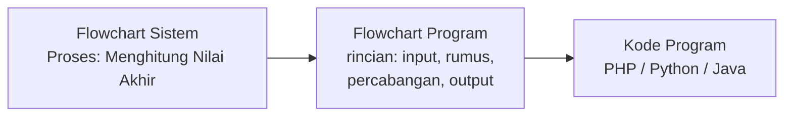

### Posisi Flowchart Program dalam pengembangan sistem

| Tahap | Dokumen yang dihasilkan | Pembaca |
| ---------------------- | ------------------------ | ------------------ |
| Analisis sistem | Flowchart Sistem | Analis, manajemen |
| Perancangan rinci | **Flowchart Program** | **Programmer** |
| Implementasi | Kode program | Programmer |
| Pengujian | Tabel penelusuran, kasus uji | QA, programmer |

Flowchart Program adalah **jembatan** antara rancangan sistem dan kode. Programmer tidak perlu menebak-nebak logika karena semuanya sudah tergambar.

### Tiga struktur dasar

Semua program, sekompleks apa pun, tersusun dari tiga struktur ini.

| Struktur | Nama lain | Ciri dalam flowchart |
| ----------- | ------------------ | -------------------------------------------------- |
| Sekuensial | Runtunan | Simbol proses berurutan tanpa percabangan |
| Seleksi | Percabangan | Ada simbol belah ketupat dengan cabang berlabel |
| Iterasi | Perulangan | Ada panah yang kembali ke simbol sebelumnya |

### Istilah penting


Gambar mengikuti bentuk pada modul referensi. Untuk konsep tanpa simbol baku, gambar merupakan **ilustrasi/contoh**, bukan notasi standar baru.

| Istilah | Simbol / ilustrasi | Arti |
| --- | --- | --- |
| Variabel |  | Wadah penyimpan nilai yang bisa berubah |
| Inisialisasi |  | Pemberian nilai awal pada variabel |
| Counter | 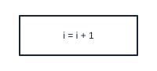 | Variabel penghitung pada perulangan |
| Akumulator | 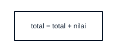 | Variabel penjumlah nilai secara bertahap |
| Predefined Process |  | Pemanggilan modul/fungsi yang sudah didefinisikan terpisah |
| Trace table | 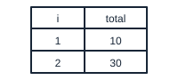 | Tabel untuk menelusuri nilai variabel langkah demi langkah |

---

## 3. Studi Kasus

### Studi kasus A — Menghitung nilai akhir

Aplikasi rapor SMK Nusantara perlu menghitung nilai akhir setiap siswa:

- Rumus: `NA = (0.3 × UH) + (0.3 × UTS) + (0.4 × UAS)`
- Predikat: `A` jika NA ≥ 90, `B` jika NA ≥ 80, `C` jika NA ≥ 75, selain itu `D`
- Siswa dinyatakan **LULUS** jika NA ≥ 75, selain itu **REMEDIAL**

### Studi kasus B — Menghitung rata-rata kelas

Aplikasi yang sama juga perlu menghitung rata-rata nilai satu kelas berisi `N` siswa, lalu menampilkan nilai tertinggi dan terendah.

### Studi kasus C — Mencari data siswa

Pengguna memasukkan NIS, sistem mencari data siswa dalam daftar. Jika ditemukan, tampilkan datanya. Jika tidak, tampilkan pesan "Data tidak ditemukan".

---

## 4. Persiapan

1. Siapkan **daftar variabel** yang akan dipakai, lengkap dengan tipe dan nilai awalnya. Tanpa ini, flowchart perulangan hampir pasti salah.
2. Tuliskan **rumus dan syarat** secara eksplisit sebelum menggambar.
3. Siapkan **minimal tiga data uji**: satu kasus normal, satu kasus batas (misal NA tepat 75), dan satu kasus ekstrem (misal nilai 0).
4. Buka draw.io atau siapkan editor Markdown untuk menulis diagram Mermaid.
5. Siapkan editor kode untuk menerjemahkan flowchart menjadi program pada bagian akhir.

---

## 5. Materi dan Praktik

### 5.1 Struktur sekuensial

Struktur paling sederhana: satu langkah dikerjakan setelah langkah sebelumnya selesai.

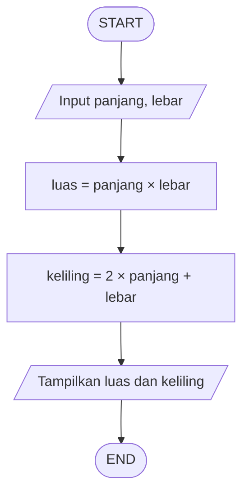

Ciri sekuensial: **tidak ada belah ketupat dan tidak ada panah yang kembali ke atas**. Alur hanya bergerak maju.

### 5.2 Struktur seleksi

#### a. Seleksi satu kondisi

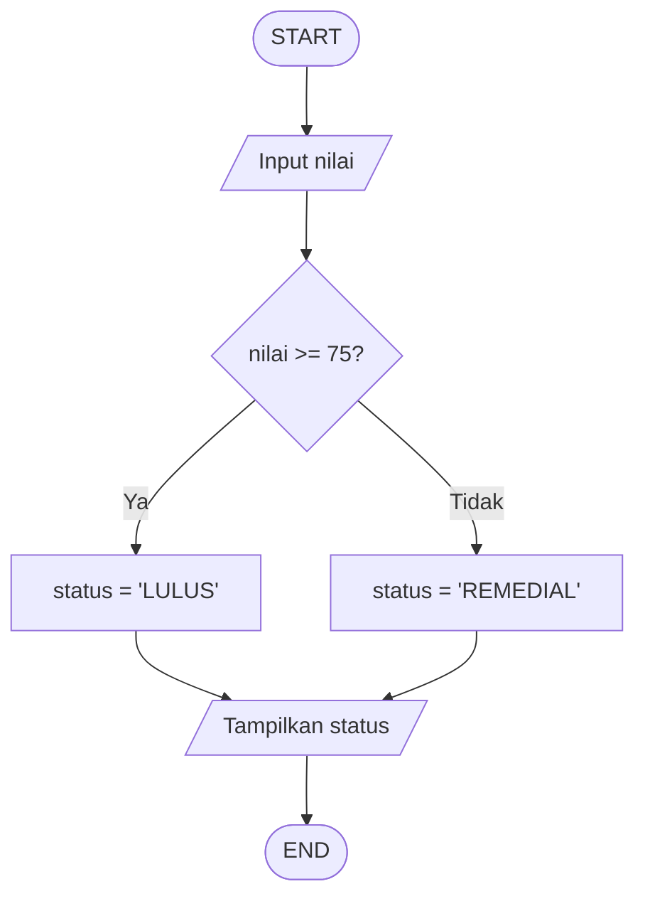

#### b. Seleksi bertingkat — praktik studi kasus A

Percabangan bertingkat digambar sebagai **rangkaian belah ketupat berurutan**. Perhatikan bahwa setiap kondisi hanya diperiksa jika kondisi sebelumnya bernilai salah.

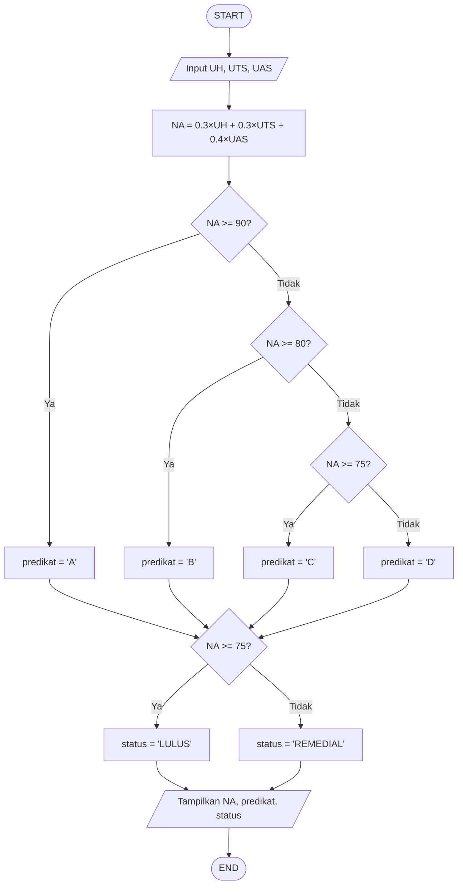

**Urutan kondisi sangat menentukan.** Jika urutannya dibalik — memeriksa `NA >= 75` lebih dulu — maka nilai 95 akan mendapat predikat `C`, karena 95 juga memenuhi syarat `>= 75`. Pada percabangan bertingkat, **periksa dari syarat paling ketat ke paling longgar**.

#### c. Uji dengan tabel penelusuran

| UH | UTS | UAS | NA | Predikat | Status |
| -- | --- | --- | ---- | -------- | -------- |
| 90 | 95 | 92 | 92,3 | A | LULUS |
| 80 | 78 | 85 | 81,4 | B | LULUS |
| 75 | 75 | 75 | 75,0 | C | LULUS |
| 70 | 68 | 72 | 70,2 | D | REMEDIAL |

Baris ketiga adalah **kasus batas** — nilai tepat 75. Kasus batas wajib diuji karena di sinilah kesalahan `>=` versus `>` paling sering terjadi.

### 5.3 Struktur iterasi

#### a. Perulangan dengan counter — praktik studi kasus B

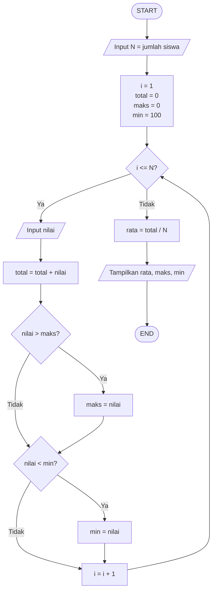

Tiga bagian wajib dalam setiap perulangan:

| Bagian | Dalam diagram di atas | Jika lupa |
| -------------- | --------------------------- | --------------------------------------- |
| Inisialisasi | `i = 1`, `total = 0` | Hasil perhitungan salah / tak terduga |
| Kondisi berhenti | `i <= N?` | Perulangan tidak pernah berhenti |
| Perubahan nilai | `i = i + 1` | Perulangan tidak pernah berhenti |

> **Penyebab nomor satu program menggantung** adalah lupa menaikkan counter (`i = i + 1`). Saat menggambar flowchart perulangan, selalu periksa ketiga bagian ini.

#### b. Simbol Preparation untuk inisialisasi

Blok inisialisasi `i = 1; total = 0; maks = 0; min = 100` sebenarnya lebih tepat digambar dengan simbol **Preparation** (bentuk segi enam) daripada simbol proses biasa. Simbol ini khusus menandai **pengaturan nilai awal** sebelum perulangan dimulai.

| Simbol | Dipakai untuk |
| ----------- | ---------------------------------------------- |
| <br>Process | Perhitungan atau penugasan di tengah alur |
| <br>Preparation | Inisialisasi variabel sebelum perulangan |

#### c. Uji dengan tabel penelusuran

Misalkan `N = 3` dengan nilai masukan 80, 95, 70.

| Iterasi | i | nilai | total | maks | min | Kondisi `i <= N` |
| ------- | - | ----- | ----- | ---- | --- | ---------------- |
| awal | 1 | — | 0 | 0 | 100 | benar |
| 1 | 1 | 80 | 80 | 80 | 80 | benar |
| 2 | 2 | 95 | 175 | 95 | 80 | benar |
| 3 | 3 | 70 | 245 | 95 | 70 | benar |
| akhir | 4 | — | 245 | 95 | 70 | **salah → keluar** |

Hasil akhir: `rata = 245 / 3 = 81,67`, `maks = 95`, `min = 70`. Flowchart terbukti benar.

### 5.4 Pencarian data — praktik studi kasus C

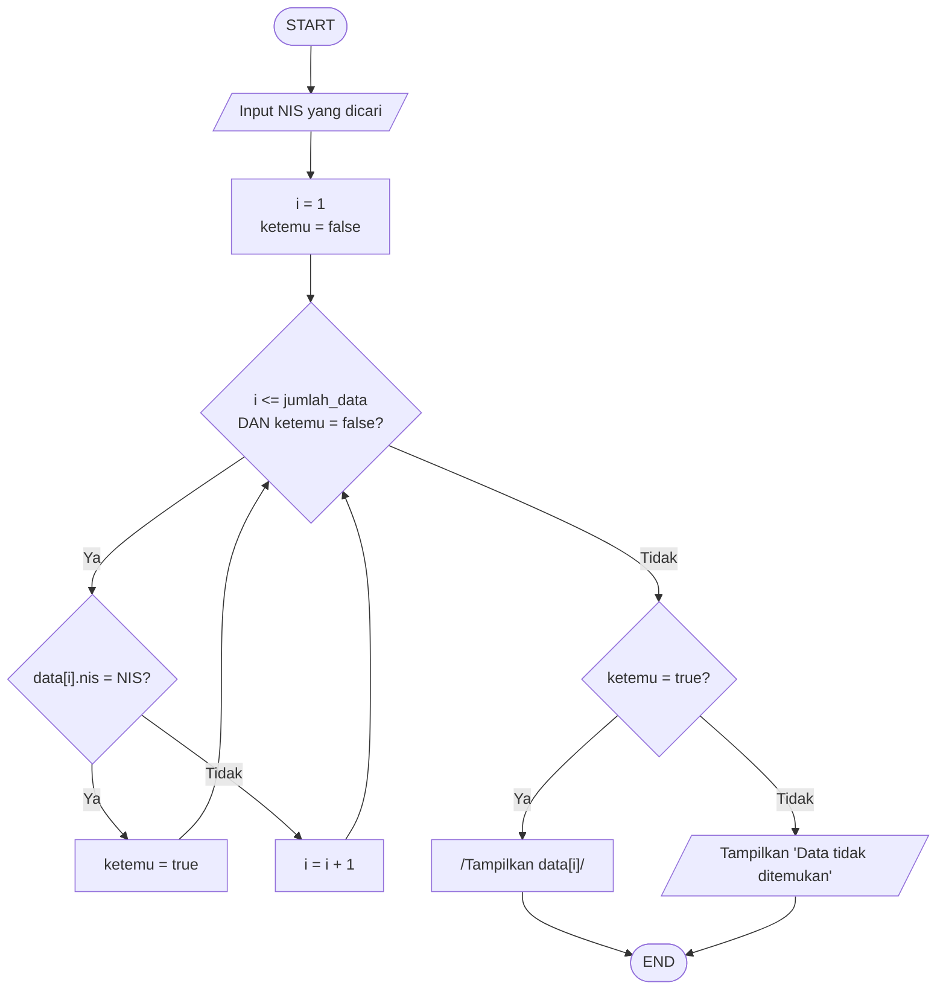

Perhatikan kondisi berhenti yang punya **dua syarat**: `i <= jumlah_data` **dan** `ketemu = false`. Perulangan berhenti ketika salah satu tidak terpenuhi — entah data habis, atau data sudah ditemukan. Ini membuat pencarian efisien karena tidak melanjutkan setelah ketemu.

### 5.5 Simbol Predefined Process

Ketika sebuah proses terlalu panjang atau dipakai berulang di banyak tempat, pecah menjadi **modul terpisah** dan panggil dengan simbol `Predefined Process` (persegi panjang dengan dua garis vertikal di sisinya).

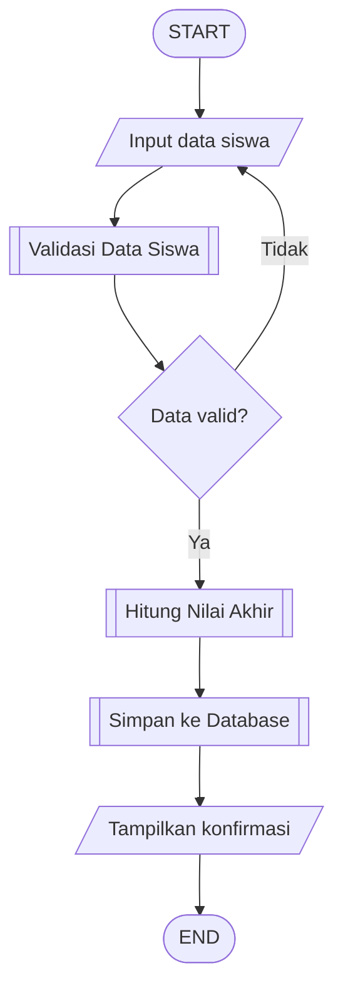

Setiap modul lalu digambar terpisah. Contoh modul `Validasi Data Siswa`:

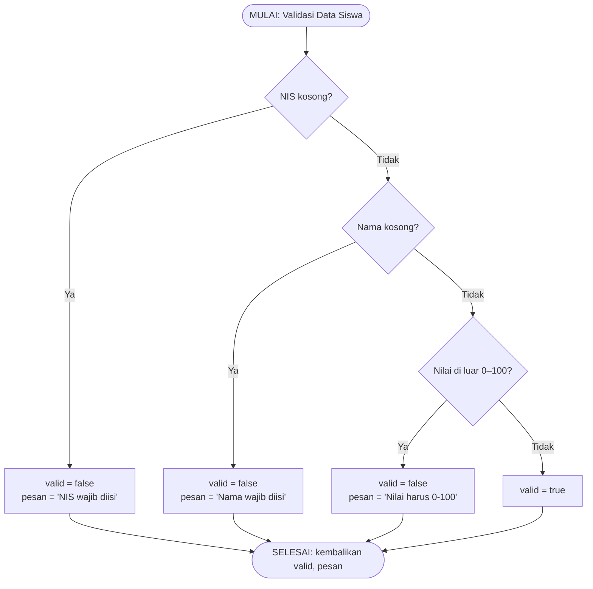

**Keuntungan memecah modul:**

| Keuntungan | Penjelasan |
| --------------------- | -------------------------------------------------------------- |
| Diagram utama ringkas | Alur besar tetap terbaca dalam satu halaman |
| Mudah dipakai ulang | Modul `Validasi Data Siswa` bisa dipanggil dari banyak tempat |
| Mudah diperbaiki | Perubahan aturan validasi cukup diubah di satu modul |
| Pembagian kerja jelas | Tiap programmer bisa mengerjakan modul berbeda |

### 5.6 Menerjemahkan flowchart menjadi kode

Flowchart yang benar bisa diterjemahkan ke kode hampir baris per baris. Berikut studi kasus A dalam PHP:

```php
<?php
// Input
$uh  = (float) readline("Nilai UH   : ");
$uts = (float) readline("Nilai UTS  : ");
$uas = (float) readline("Nilai UAS  : ");

// Proses: NA = 0.3*UH + 0.3*UTS + 0.4*UAS
$na = (0.3 * $uh) + (0.3 * $uts) + (0.4 * $uas);

// Seleksi bertingkat: ketat ke longgar
if ($na >= 90) {
    $predikat = 'A';
} elseif ($na >= 80) {
    $predikat = 'B';
} elseif ($na >= 75) {
    $predikat = 'C';
} else {
    $predikat = 'D';
}

$status = ($na >= 75) ? 'LULUS' : 'REMEDIAL';

// Output
echo "Nilai Akhir : " . number_format($na, 2) . PHP_EOL;
echo "Predikat    : $predikat" . PHP_EOL;
echo "Status      : $status" . PHP_EOL;
```

Pemetaan simbol ke kode:

| Simbol flowchart | Padanan dalam kode |
| ------------------------- | ------------------------------------ |
| Input/Output (jajar genjang) | `readline()`, `echo` |
| Process (persegi panjang) | Penugasan nilai, perhitungan |
| Decision (belah ketupat) | `if`, `elseif`, `else` |
| 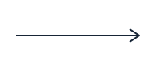<br>Panah kembali ke atas | `while`, `for`, `do-while` |
| <br>Predefined Process | Pemanggilan fungsi |
| <br>Preparation | Inisialisasi variabel sebelum loop |

Studi kasus B dalam PHP:

```php
<?php
$n     = (int) readline("Jumlah siswa : ");
$total = 0;
$maks  = 0;
$min   = 100;

for ($i = 1; $i <= $n; $i++) {
    $nilai  = (float) readline("Nilai siswa ke-$i : ");
    $total += $nilai;
    if ($nilai > $maks) { $maks = $nilai; }
    if ($nilai < $min)  { $min  = $nilai; }
}

$rata = $total / $n;
echo "Rata-rata : " . number_format($rata, 2) . PHP_EOL;
echo "Tertinggi : $maks" . PHP_EOL;
echo "Terendah  : $min" . PHP_EOL;
```

Perhatikan bahwa `for ($i = 1; $i <= $n; $i++)` memuat **ketiga bagian perulangan** sekaligus: inisialisasi, kondisi berhenti, dan perubahan nilai — persis seperti yang digambar pada flowchart.

### 5.7 Menurunkan Flowchart Program dari Flowchart Sistem

Latihan terpadu. Perhatikan potongan Flowchart Sistem berikut:

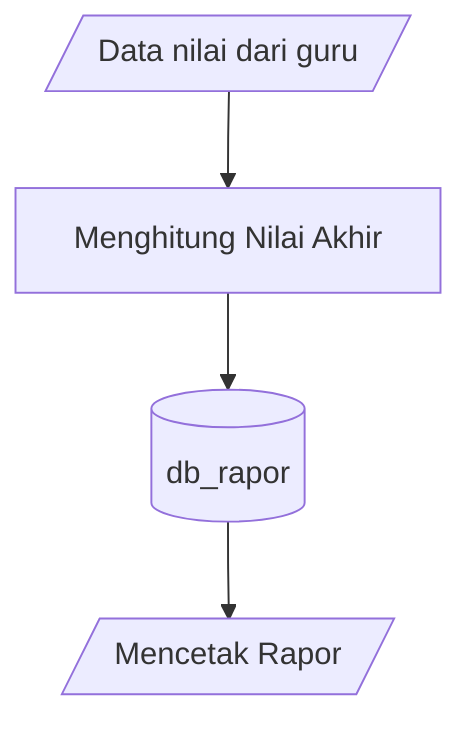

Simbol `Menghitung Nilai Akhir` tampak sederhana, padahal di dalamnya terdapat seluruh logika pada bagian 5.2. Inilah yang dimaksud **penurunan**: satu kotak di Flowchart Sistem menjadi satu Flowchart Program utuh.

| Langkah penurunan | Yang dilakukan |
| ------------------------------------- | -------------------------------------------------------- |
| 1. Pilih satu proses di Flowchart Sistem | Misalnya `Menghitung Nilai Akhir` |
| 2. Tentukan input dan output proses | Input: UH, UTS, UAS. Output: NA, predikat, status |
| 3. Rinci langkah di dalamnya | Rumus, percabangan predikat, penentuan status |
| 4. Gambar Flowchart Program-nya | Seperti diagram pada bagian 5.2.b |
| 5. Uji dengan tabel penelusuran | Termasuk kasus batas |
| 6. Terjemahkan menjadi kode | Seperti contoh PHP pada bagian 5.6 |

---

## 6. Rangkuman

- **Flowchart Program** merinci langkah logika program dan **diturunkan dari Flowchart Sistem**.
- Satu simbol proses di Flowchart Sistem bisa berkembang menjadi satu Flowchart Program utuh.
- Tiga struktur dasar: **sekuensial, seleksi, dan iterasi**.
- Pada **seleksi bertingkat**, periksa kondisi dari **syarat paling ketat ke paling longgar**.
- Setiap **perulangan** wajib punya tiga bagian: inisialisasi, kondisi berhenti, dan perubahan nilai.
- Simbol **Preparation** untuk inisialisasi, **Predefined Process** untuk memanggil modul terpisah.
- **Tabel penelusuran** adalah cara menguji kebenaran flowchart sebelum ditulis menjadi kode.
- Selalu uji **kasus batas** (nilai tepat di ambang syarat) dan **kasus ekstrem**.

---

## 7. Latihan

1. Jelaskan hubungan Flowchart Sistem dan Flowchart Program dengan kalimatmu sendiri, lengkap dengan satu contoh.
2. Buat Flowchart Program untuk menghitung **gaji karyawan**: `gaji = (jam_kerja × tarif)`; jika jam kerja lebih dari 40, kelebihannya dibayar 1,5 kali tarif.
3. Buat Flowchart Program untuk menampilkan **bilangan genap dari 1 sampai N** beserta jumlahnya.
4. Buat tabel penelusuran untuk soal nomor 3 dengan `N = 10`.
5. Buat Flowchart Program untuk **menentukan bilangan prima**. Gunakan perulangan dan pastikan ketiga bagian perulangan lengkap.
6. Pecah soal nomor 5 menjadi dua modul memakai `Predefined Process`: modul utama dan modul `Cek Prima`.
7. Terjemahkan flowchart nomor 2 menjadi kode PHP atau bahasa lain yang kamu kuasai.
8. Perhatikan flowchart berikut dan temukan kesalahannya:

   ```mermaid
   flowchart TD
       A([START]) --> B[i = 1]
       B --> C{i <= 10?}
       C -->|Ya| D[/Tampilkan i/]
       D --> C
       C -->|Tidak| E([END])
   ```

---

## 8. Kuis

1. Flowchart Program diturunkan dari ….
   a. Flowchart Proses  b. Flowchart Sistem  c. Flowchart Dokumen  d. Flowchart Skematik
2. Pembaca utama Flowchart Program adalah ….
   a. Manajemen  b. Auditor  c. Programmer  d. Pelanggan
3. Tiga struktur dasar algoritma adalah ….
   a. Input, proses, output  b. Sekuensial, seleksi, iterasi  c. Mulai, proses, selesai  d. Analisis, desain, implementasi
4. Pada percabangan bertingkat, kondisi sebaiknya diperiksa dari ….
   a. Paling longgar ke paling ketat  b. Paling ketat ke paling longgar  c. Acak  d. Dari tengah
5. Bagian yang jika terlupa membuat perulangan tidak pernah berhenti adalah ….
   a. Inisialisasi  b. Perubahan nilai counter  c. Output  d. Input
6. Simbol yang dipakai untuk memanggil modul yang sudah didefinisikan terpisah adalah ….
   a. Preparation  b. Predefined Process  c. Merge  d. Connector
7. Tabel penelusuran (trace table) digunakan untuk ….
   a. Menghitung biaya program  b. Menguji kebenaran logika flowchart  c. Mendesain antarmuka  d. Mengatur basis data
8. Kasus batas yang wajib diuji pada syarat `NA >= 75` adalah ….
   a. NA = 0  b. NA = 100  c. NA = 75  d. NA = 50

---

## 9. Kesalahan Umum

| Kesalahan | Akibat | Perbaikan |
| -------------------------------------------------------- | --------------------------------------------------- | --------------------------------------------------------------- |
| Lupa menaikkan counter pada perulangan | Program menggantung, tidak pernah berhenti | Pastikan ada simbol `i = i + 1` di dalam badan perulangan |
| Lupa inisialisasi akumulator | Hasil penjumlahan salah atau tak terduga | Beri nilai awal `total = 0` sebelum perulangan |
| Urutan kondisi bertingkat terbalik | Nilai 95 bisa mendapat predikat `C` | Periksa dari syarat paling ketat ke paling longgar |
| Tidak menguji kasus batas | Kesalahan `>` versus `>=` lolos ke produksi | Uji nilai tepat di ambang syarat, misalnya NA = 75 |
| Cabang keputusan tidak bertemu kembali | Sebagian alur tidak pernah sampai ke output | Satukan kembali cabang sebelum simbol output |
| Satu flowchart memuat terlalu banyak logika | Diagram tidak muat satu halaman dan sulit dibaca | Pecah memakai `Predefined Process` |
| Memakai Flowchart Sistem untuk merinci logika program | Rincian tidak cukup bagi programmer | Turunkan menjadi Flowchart Program |
| Menulis kode langsung tanpa flowchart | Logika percabangan sering terlewat | Gambar dulu, uji dengan trace table, baru tulis kode |
| Memakai kata benda pada deskripsi proses | Tidak jelas apa yang dikerjakan | Awali dengan kata kerja atau tulis sebagai rumus penugasan |
