# Modul 5 — DFD dan Perancangan Terstruktur

**Mata pelajaran:** Analisis dan Desain Sistem Informasi (ADSI) — RPL
**Alat:** draw.io / diagrams.net (shape library *Flowchart* dan *Entity Relation*), Mermaid (opsional)
**Studi kasus:** Sistem Penjualan dan Sistem Penggajian Karyawan
**Prasyarat:** Modul 1 sampai Modul 4

---

## 1. Tujuan Pembelajaran

Setelah mempelajari modul ini, kamu mampu:

1. Menjelaskan pengertian DFD (Data Flow Diagram) / DAD (Diagram Arus Data) dan perbedaannya dengan flowchart.
2. Menyebutkan tiga alasan pentingnya pemodelan sistem.
3. Membedakan notasi DeMarco & Yourdon dengan Gane & Sarson.
4. Menggunakan empat simbol DFD — External Entity, Data Flow, Proses, dan Data Store — sesuai aturannya.
5. Menggambar **Context Diagram** sebuah sistem dengan benar.
6. Menyusun **Bagan Berjenjang** (*hierarchy chart*) sebagai dasar pemecahan level.
7. Menggambar **DAD Level 0** dan **DAD Level 1** yang seimbang dengan diagram induknya.
8. Mengenali dan memperbaiki enam kesalahan umum dalam menggambar DFD.

---

## 2. Konsep Dasar

### Apa itu DFD?

**DFD (Data Flow Diagram)** atau **DAD (Diagram Arus Data)** adalah alat pemodelan yang menggambarkan **arus data di dalam sistem secara logika**, tanpa memperhatikan lingkungan fisik tempat data tersebut mengalir.

Kata kunci: **logika**, bukan fisik.

| Pertanyaan | Dijawab DFD? |
| ------------------------------------------- | ------------ |
| Data apa yang masuk ke sistem? | ✅ |
| Proses apa yang mengolah data tersebut? | ✅ |
| Data apa yang disimpan dan di mana? | ✅ |
| Siapa yang menerima keluaran sistem? | ✅ |
| **Kapan** proses dijalankan? | ❌ |
| **Bagaimana urutan** langkah prosesnya? | ❌ |
| **Perangkat apa** yang dipakai? | ❌ |

### DFD versus Flowchart

| Aspek | Flowchart | DFD |
| ------------------ | ------------------------------- | ----------------------------------- |
| Yang digambarkan | Urutan langkah dan kendali alur | Arus data antar proses |
| Ada percabangan? | Ya, simbol keputusan | **Tidak ada simbol keputusan** |
| Ada urutan waktu? | Ya, jelas berurutan | **Tidak menunjukkan urutan waktu** |
| Penekanan | Bagaimana | Apa |
| Level bertingkat | Jarang | **Ya, berjenjang Level 0, 1, 2 …** |

> **Kesalahan paling sering:** menggambar DFD seolah-olah flowchart, lengkap dengan percabangan "Ya/Tidak". DFD **tidak punya simbol keputusan**.

### Mengapa perlu memodelkan sistem?

Ada tiga alasan utama:

1. **Memusatkan perhatian pada hal yang penting** dalam sistem, tanpa terganggu detail yang belum perlu.
2. **Mendiskusikan perubahan dan koreksi** terhadap kebutuhan pemakai dengan **risiko dan biaya minimal** — mengubah gambar jauh lebih murah daripada mengubah program yang sudah jadi.
3. **Menguji pengertian penganalisa sistem** terhadap kebutuhan pemakai, serta membantu pendesain dan pemrogram membangun sistem.

### Model lain selain DFD

| Jenis model | Contoh | Kelemahan |
| ----------- | ---------------------------------------- | ------------------------------------------ |
| Narasi | Dokumen uraian sistem | Panjang, mudah ambigu |
| Prototype | Tiruan tampilan aplikasi | Butuh waktu dan sumber daya lebih besar |
| Grafis | **DFD**, ERD, flowchart | Perlu pemahaman notasi |

### Istilah penting

Gambar mengikuti bentuk pada modul referensi. Untuk konsep tanpa simbol baku, gambar merupakan **ilustrasi/contoh**, bukan notasi standar baru.

| Istilah | Simbol / ilustrasi | Arti |
| --- | --- | --- |
| External Entity |  | Kesatuan luar yang berinteraksi dengan sistem |
| Data Flow | 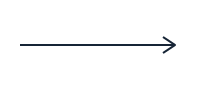 | Arus data yang mengalir antar simbol |
| Proses |  | Kegiatan yang mengubah arus data masuk menjadi arus data keluar |
| Data Store | 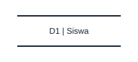 | Simpanan data |
| Terminator |  | Sebutan lain untuk External Entity |
| Primitive |  | Proses yang tidak dapat dipecah lagi, ditandai huruf `P` |
| Dekomposisi | 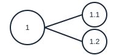 | Pemecahan proses menjadi proses-proses yang lebih kecil |
| Balancing | 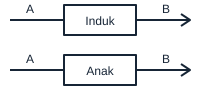 | Keseimbangan input/output antara diagram induk dan diagram anak |

---

## 3. Studi Kasus

### Studi kasus A — Sistem Penjualan

Sistem penjualan sebuah perusahaan dagang melibatkan empat pihak luar:

| Kesatuan luar | Input ke sistem | Output dari sistem |
| ------------------ | ------------------------------ | --------------------------------------------------- |
| Pelanggan | Order pelanggan | Faktur |
| Gudang | — | Tembusan Permintaan Persediaan |
| Bagian Pengiriman | Tembusan jurnal | Faktur, tembusan Kredit, dan tembusan Jurnal |
| Manajer Kredit | — | Status piutang |

### Studi kasus B — Sistem Penggajian Karyawan

Sistem penggajian menerima data kehadiran dari karyawan dan data potongan dari bagian personalia, lalu menghasilkan slip gaji untuk karyawan, laporan gaji untuk manajer, dan data pembayaran untuk bagian keuangan.

---

## 4. Persiapan

1. Buka draw.io. Aktifkan shape library **Flowchart** dan cari bentuk persegi panjang bersudut tumpul (Gane & Sarson) atau lingkaran (Yourdon).
2. Siapkan **daftar kesatuan luar** beserta input dan output masing-masing — ini adalah langkah pertama yang wajib.
3. Sepakati **satu notasi saja** untuk seluruh dokumen. Jangan mencampur Yourdon dan Gane & Sarson.
4. Siapkan **penomoran proses** yang konsisten: Context = 0, Level 0 = 1, 2, 3 …, Level 1 = 1.1, 1.2, 2.1 …
5. Siapkan **kamus data sederhana** berupa tabel nama arus data dan isinya.

---

## 5. Materi dan Praktik

### 5.1 Empat simbol DFD dan dua notasinya

| Komponen | Notasi DeMarco & Yourdon | Notasi Gane & Sarson |
| ---------------- | -------------------------------- | -------------------------------------- |
| External Entity |  Persegi panjang |  Persegi panjang dengan bayangan |
| Data Flow |  Panah |  Panah |
| Proses |  **Lingkaran** | 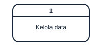 **Persegi panjang bersudut tumpul** |
| Data Store |  Dua garis sejajar | 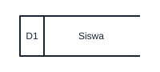 Persegi panjang terbuka di sisi kanan |

Keduanya sah. Yang penting, **pilih satu dan konsisten** dalam satu dokumen.

### 5.2 External Entity (Kesatuan Luar)

Kesatuan luar adalah **batas sistem** — pihak di luar sistem yang memberi input atau menerima output.

Enam bentuk kesatuan luar:

| No | Bentuk | Contoh |
| -- | ---------------------------------------------------------------- | ----------------------------------- |
| 1 | Kantor, departemen, atau divisi di luar sistem yang dimodelkan | Bagian Gudang, Bagian Pengiriman |
| 2 | Orang atau kelompok di organisasi tetapi di luar sistem | Manajer Kredit, Kepala Sekolah |
| 3 | Organisasi atau orang di luar organisasi | Pelanggan, Pemasok |
| 4 | Sistem informasi lain | Sistem Akuntansi, Sistem Persediaan |
| 5 | Sumber asli suatu transaksi | Calon siswa yang mendaftar |
| 6 | Penerima akhir dari suatu laporan | Direktur, Dinas Pendidikan |

**Aturan penamaan:** kesatuan luar diberi nama berupa **kata benda**.

### 5.3 Data Flow (Arus Data)

Arus data menunjukkan data yang mengalir dari satu simbol ke simbol lain. Sembilan bentuk arus data:

| No | Bentuk arus data | Contoh nyata |
| -- | --------------------------------------------- | -------------------------------------- |
| 1 | Formulir atau dokumen | Formulir pendaftaran |
| 2 | Laporan tercetak | Laporan penjualan bulanan |
| 3 | Tampilan atau output di layar komputer | Hasil pencarian data siswa |
| 4 | Masukan untuk komputer | Data yang diketik operator |
| 5 | Komunikasi ucapan | Pesanan via telepon |
| 6 | Surat atau memo | Surat permohonan izin |
| 7 | Data yang dibaca atau direkam ke suatu file | Data siswa yang disimpan ke database |
| 8 | Suatu isian yang dicatat pada buku agenda | Catatan di buku tamu |
| 9 | Transmisi data dari satu komputer ke komputer lain | Sinkronisasi data antar cabang |

**Aturan penamaan:** arus data diberi nama berupa **kata benda**, misalnya `Order Pelanggan`, `Faktur`, `Data Kehadiran`. Jangan memberi nama seperti `data` saja atau `informasi` saja.

#### Empat konsep arus data

| Konsep | Penjelasan |
| ------------------------- | ---------------------------------------------------------------- |
| **Packet of data** | Data yang mengalir bersamaan harus digambar sebagai **satu** arus data, bukan beberapa panah terpisah |
| **Diverging data flow** | Satu arus data **terpecah** menjadi beberapa arus data berbeda |
| **Converging data flow** | Beberapa arus data **bergabung** menjadi satu arus data |
| **Sumber dan tujuan** | Setiap arus data harus berawal dan/atau berakhir pada **minimal satu proses** |

Konsep keempat adalah yang paling sering dilanggar. Artinya: **arus data tidak boleh langsung menghubungkan dua simbol non-proses**.

### 5.4 Proses

Proses adalah kegiatan yang **mengubah arus data masuk menjadi arus data keluar**.

Setiap simbol proses harus memuat dua hal:

| Bagian | Letak | Contoh |
| --------------- | ------------------------- | -------------- |
| Identifikasi | Nomor acuan di bagian atas | `1`, `2.1` |
| Nama proses | Di bawah nomor | `Memproses Order Pelanggan` |

**Aturan penamaan proses:** gunakan pola **kata kerja – kata sifat – kata benda**.

| Nama proses yang benar | Nama proses yang salah | Alasan |
| ---------------------------------- | --------------------------- | ----------------------------- |
| Menghitung Gaji Karyawan | Gaji | Bukan kata kerja |
| Memvalidasi Data Pendaftaran | Data Pendaftaran | Bukan kata kerja |
| Mencetak Laporan Penjualan | Laporan | Bukan kata kerja |
| Memproses Order Pelanggan | Proses 1 | Tidak menjelaskan apa pun |

### 5.5 Data Store (Simpanan Data)

Lima bentuk simpanan data:

| No | Bentuk | Contoh |
| -- | ----------------------------------------------- | -------------------------------- |
| 1 | File atau database di sistem komputer | Tabel `siswa` di MySQL |
| 2 | Arsip atau catatan manual | Map arsip surat masuk |
| 3 | Kotak tempat data di meja seseorang | Kotak formulir yang belum diproses |
| 4 | Tabel acuan manual | Tabel tarif pengiriman |
| 5 | Agenda atau buku | Buku induk siswa |

#### Empat aturan simpanan data

| Aturan | Arti |
| ------------------------------------------------------- | ------------------------------------------------------------ |
| 1. Hanya **proses** yang boleh terhubung ke data store | Entity ↔ data store langsung = **salah** |
| 2. Arus data **menuju** data store | Berarti proses melakukan **update**: tambah, ubah, atau hapus |
| 3. Arus data **dari** data store | Berarti proses **membaca/memakai** data |
| 4. Jika terjadi keduanya | Digambar **panah dua arah** atau **dua garis terpisah** |

### 5.6 Praktik: Context Diagram Sistem Penjualan

#### a. Langkah 1 — identifikasi kesatuan luar

Sudah tersedia pada bagian Studi Kasus A: Pelanggan, Gudang, Bagian Pengiriman, Manajer Kredit.

#### b. Langkah 2 — identifikasi input dan output tiap kesatuan luar

| Kesatuan luar | Input ke sistem | Output dari sistem |
| ------------------ | --------------- | -------------------------------------------- |
| Pelanggan | Order pelanggan | Faktur |
| Gudang | — | Tembusan Permintaan Persediaan |
| Bagian Pengiriman | Tembusan jurnal | Faktur, tembusan Kredit, dan tembusan Jurnal |
| Manajer Kredit | — | Status piutang |

#### c. Langkah 3 — gambar Context Diagram

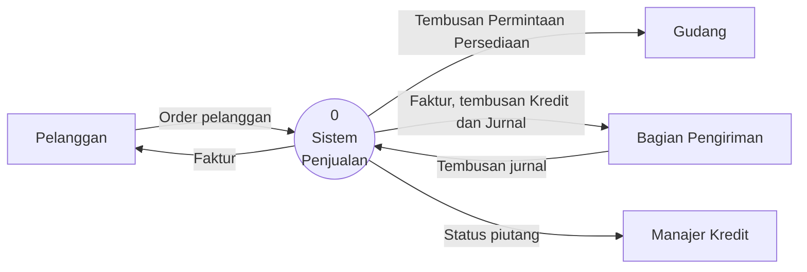

#### d. Tiga aturan Context Diagram

| Aturan | Penjelasan |
| ---------------------------------------------------------------------- | ----------------------------------------------------------- |
| 1. Hanya ada **satu proses**, bernomor **nol** | Mewakili seluruh sistem |
| 2. Terminator dengan banyak input/output boleh digambar **lebih dari sekali**, ditandai `*` atau `#` | Supaya garis tidak saling bersilangan |
| 3. Terminator diwakili **peran/jabatan**, bukan nama personil | Tulis `Manajer Kredit`, bukan `Pak Budi` |

Tambahan penting: **handler** — pihak yang hanya meneruskan data tanpa mengolahnya — **tidak perlu digambar**. Contohnya kurir yang mengantar surat.

Catatan: Context Diagram **tidak memuat data store**. Simpanan data baru muncul di Level 0.

### 5.7 Praktik: Bagan Berjenjang (Hierarchy Chart)

Sebelum memecah Context Diagram menjadi Level 0, susun dulu **Bagan Berjenjang**. Bagan ini adalah daftar semua proses dan sub-prosesnya.

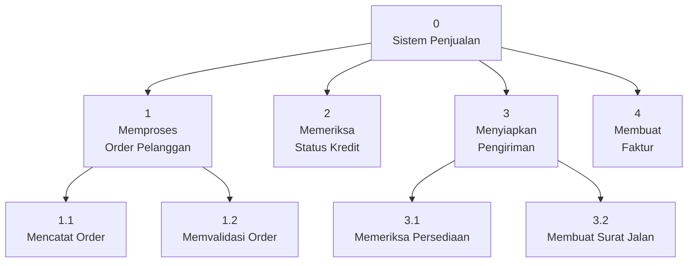

Bagan Berjenjang menjawab pertanyaan: **berapa level yang dibutuhkan dan proses mana yang perlu dipecah lagi.** Proses 2 dan 4 pada contoh tidak dipecah, berarti keduanya sudah *primitive*.

### 5.8 Praktik: DAD Level 0 (Overview Diagram)

DAD Level 0 adalah hasil pemecahan proses nol.

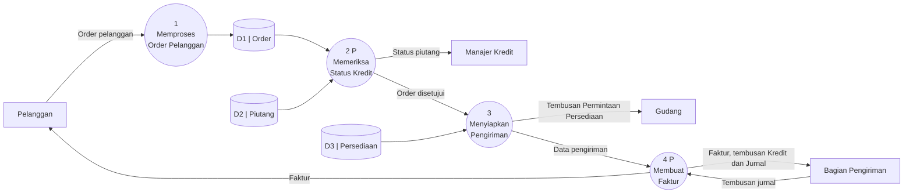

Perhatikan tiga hal:

| Hal yang diperhatikan | Penjelasan |
| ---------------------------------- | ------------------------------------------------------------------------ |
| Huruf **`P`** setelah nomor proses | Singkatan **Primitive** — proses tidak dapat dipecah lagi ke level berikutnya |
| Data store mulai muncul | Diberi kode `D1`, `D2`, `D3` |
| Semua kesatuan luar tetap sama | Pelanggan, Gudang, Bagian Pengiriman, Manajer Kredit — tidak berkurang atau bertambah |

Hal ketiga berkaitan dengan **balancing**: seluruh input dan output pada Context Diagram **harus muncul kembali** di Level 0.

### 5.9 Praktik: DAD Level 1

Proses yang **tidak** bertanda `P` dipecah lagi. Pada contoh ini, proses 1 dan proses 3 dipecah. Berikut DAD Level 1 untuk proses 1.

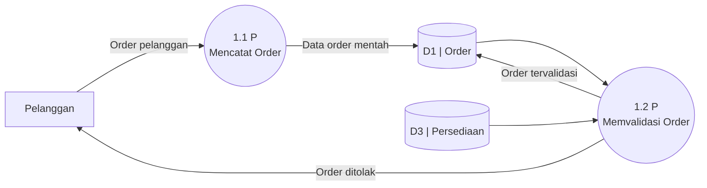

Aturan **balancing**: input dan output diagram anak **harus sama** dengan input dan output proses induknya.

| Pada Level 0 (proses 1) | Pada Level 1 (proses 1.1 dan 1.2) | Seimbang? |
| -------------------------------- | ---------------------------------------- | --------- |
| Input: Order pelanggan | Input: Order pelanggan (ke proses 1.1) | ✅ |
| Output: data ke `D1 Order` | Output: data ke `D1 Order` (dari 1.1, 1.2) | ✅ |

Jika diagram anak punya input atau output yang **tidak ada** di proses induknya, berarti ada kesalahan — entah di induk atau di anaknya.

### 5.10 Enam kesalahan umum dalam DFD

#### a. Lupa menyertakan aliran data atau arah panah salah

Setiap proses **wajib punya minimal satu input dan satu output**.

| Kasus | Julukan | Mengapa salah |
| ------------------------------- | ------------------- | ----------------------------------------------- |
| Proses punya input, tanpa output | *Black hole* | Data masuk tapi tidak menghasilkan apa pun |
| Proses punya output, tanpa input | *Miracle / spontaneous generation* | Data muncul dari ketiadaan |

#### b. Menghubungkan simbol yang tidak boleh dihubungkan langsung

| Hubungan | Boleh? | Keterangan |
| ----------------------------------- | ------ | --------------------------------------- |
| Data store ↔ External entity | ❌ | Harus lewat proses |
| Data store ↔ Data store | ❌ | Harus lewat proses |
| External entity ↔ External entity | ❌ | Harus lewat proses |
| Proses ↔ apa pun | ✅ | Proses boleh terhubung ke semua simbol |

**Aturan ringkas: setiap arus data harus menyentuh minimal satu proses.**

#### c. Label tidak tepat

| Komponen | Pola penamaan | Contoh benar |
| ----------- | ------------------------------------ | ---------------------------- |
| Proses |  kata kerja – kata sifat – kata benda |  `Menghitung Gaji Karyawan` |
| Arus data | kata benda | `Data Kehadiran` |
| Data store | kata benda | `D1 Karyawan` |
| Entity | kata benda (peran/jabatan) | `Manajer Kredit` |

#### d. Terlalu banyak proses dalam satu diagram

Batas wajar adalah **maksimal 9 proses** dalam satu diagram. Jika lebih, diagram menjadi tidak terbaca. Solusinya: gabungkan proses sejenis menjadi satu proses induk, lalu pecah di level berikutnya.

#### e. Mengabaikan aliran data yang dibutuhkan proses

Setiap proses harus menerima **semua** data yang diperlukannya.

Contoh: proses `Menghitung Jumlah Pemotongan Pajak` tidak cukup menerima data gaji saja. Proses ini juga membutuhkan:

- **Jumlah Tanggungan** — untuk menentukan Penghasilan Tidak Kena Pajak
- **Suku Bunga** / tarif pajak yang berlaku

Tanpa kedua data tersebut, proses tidak mungkin menghasilkan output yang benar.

#### f. Analisis tidak seimbang (*unbalanced decomposition*)

Diagram anak **harus** memiliki input dan output yang sama dengan proses induknya. Pelanggaran yang sering terjadi:

| Pelanggaran | Cara memperbaiki |
| --------------------------------------------- | ----------------------------------------------------- |
| Diagram anak punya input yang tidak ada di induk | Tambahkan input tersebut di diagram induk |
| Diagram anak kehilangan output milik induk | Tambahkan output yang hilang di diagram anak |
| Nama arus data berubah antar level | Samakan nama arus data di semua level |

### 5.11 Praktik mandiri terbimbing: Sistem Penggajian Karyawan

Kerjakan bertahap mengikuti pola yang sudah dipelajari.

#### a. Langkah 1 — tabel kesatuan luar

| Kesatuan luar | Input ke sistem | Output dari sistem |
| ----------------- | ---------------------------------- | ------------------------ |
| Karyawan | Data kehadiran | Slip gaji |
| Bagian Personalia | Data karyawan, data potongan | — |
| Manajer | — | Laporan gaji |
| Bagian Keuangan | — | Data pembayaran gaji |

#### b. Langkah 2 — Context Diagram

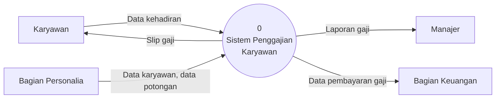

#### c. Langkah 3 — Bagan Berjenjang

| Nomor | Nama proses | Dipecah lagi? |
| ----- | ------------------------------- | ------------- |
| 1 | Mengelola Data Karyawan | Tidak (`P`) |
| 2 | Merekap Kehadiran Karyawan | Tidak (`P`) |
| 3 | Menghitung Gaji Karyawan | Ya → 3.1, 3.2 |
| 3.1 | Menghitung Gaji Kotor | Tidak (`P`) |
| 3.2 | Menghitung Potongan dan Pajak | Tidak (`P`) |
| 4 | Mencetak Laporan Gaji | Tidak (`P`) |

#### d. Langkah 4 — DAD Level 0

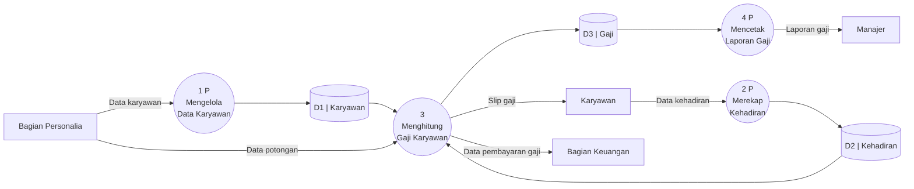

#### e. Langkah 5 — periksa balancing

| Pada Context Diagram | Pada Level 0 | Seimbang? |
| ----------------------------- | ---------------------------------------- | --------- |
| Data kehadiran (dari Karyawan) | Masuk ke proses 2 | ✅ |
| Data karyawan, data potongan (dari Personalia) | Masuk ke proses 1 dan 3 | ✅ |
| Slip gaji (ke Karyawan) | Keluar dari proses 3 | ✅ |
| Laporan gaji (ke Manajer) | Keluar dari proses 4 | ✅ |
| Data pembayaran gaji (ke Keuangan) | Keluar dari proses 3 | ✅ |

Seluruh arus data pada Context Diagram muncul kembali di Level 0. Diagram **seimbang**.

#### f. Langkah 6 — DAD Level 1 untuk proses 3

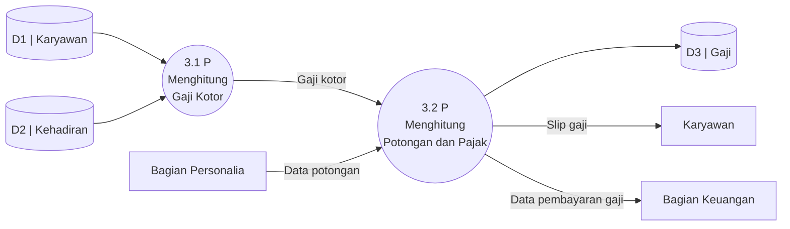

Bandingkan input/output diagram ini dengan proses 3 pada Level 0 — keduanya identik. Dekomposisi berhasil.

---

## 6. Rangkuman

- **DFD/DAD** menggambarkan arus data **secara logika**, tanpa memperhatikan lingkungan fisik.
- DFD **tidak memiliki simbol keputusan** dan **tidak menunjukkan urutan waktu**. Itu tugas flowchart.
- Tiga alasan pemodelan: memusatkan perhatian pada hal penting, mendiskusikan perubahan dengan risiko dan biaya minimal, serta menguji pengertian penganalisa.
- Empat simbol: **External Entity, Data Flow, Proses, Data Store**. Dua notasi: **DeMarco & Yourdon** dan **Gane & Sarson** — pilih satu dan konsisten.
- **Setiap arus data harus menyentuh minimal satu proses.** Data store ↔ entity, data store ↔ data store, dan entity ↔ entity dilarang.
- Penamaan: proses = **kata kerja – kata sifat – kata benda**; arus data, data store, dan entity = **kata benda**.
- **Context Diagram**: satu proses bernomor **nol**, tanpa data store, terminator diwakili peran bukan nama orang.
- **Bagan Berjenjang** disusun sebelum memecah ke Level 0, untuk menentukan berapa level yang dibutuhkan.
- Huruf **`P`** setelah nomor proses berarti **Primitive** — tidak dapat dipecah lagi.
- **Balancing**: input dan output diagram anak harus sama dengan proses induknya.
- Maksimal **9 proses** dalam satu diagram.

---

## 7. Latihan

1. Jelaskan tiga perbedaan mendasar antara DFD dan flowchart.
2. Sebutkan tiga alasan pentingnya pemodelan sistem, lalu berikan satu contoh nyata untuk alasan kedua.
3. Sebutkan enam bentuk kesatuan luar dan berikan satu contoh berbeda untuk masing-masing dari lingkungan sekolahmu.
4. Jelaskan empat konsep arus data: *packet of data*, *diverging*, *converging*, serta sumber dan tujuan arus data.
5. Tuliskan empat aturan simpanan data, lalu jelaskan kapan panah dua arah dipakai.
6. Buat **Context Diagram** untuk **Sistem Perpustakaan Sekolah**. Identifikasi dulu kesatuan luar beserta input dan outputnya dalam bentuk tabel.
7. Susun **Bagan Berjenjang** untuk sistem nomor 6, minimal dua level. Tandai proses yang *primitive* dengan huruf `P`.
8. Gambar **DAD Level 0** untuk sistem nomor 6, lengkap dengan data store.
9. Periksa **balancing** antara Context Diagram dan Level 0 yang kamu buat. Sajikan dalam tabel seperti contoh bagian 5.11.e.
10. Perhatikan pernyataan berikut dan tentukan mana yang melanggar aturan DFD beserta alasannya:
    a. `D1 Siswa` → `Wali Kelas`
    b. `Pelanggan` → `Pemasok`
    c. `Proses 2` → `D3 Transaksi`
    d. `D2 Stok` → `D3 Transaksi`
11. Perbaiki nama-nama berikut agar sesuai aturan penamaan DFD: `Data`, `Proses 1`, `Laporan`, `Hitung`, `Pak Andi`.
12. Buat **DAD Level 1** untuk salah satu proses pada sistem nomor 8 yang belum bertanda `P`.

---

## 8. Kuis

1. DFD menggambarkan arus data secara ….
   a. Fisik  b. Logika  c. Kronologis  d. Hierarkis
2. Simbol yang **tidak ada** dalam DFD adalah ….
   a. Proses  b. Data store  c. **Keputusan**  d. External entity
3. Pada notasi DeMarco & Yourdon, proses digambar dengan bentuk ….
   a. Persegi panjang  b. Lingkaran  c. Belah ketupat  d. Jajar genjang
4. Nomor proses pada Context Diagram adalah ….
   a. 1  b. 0  c. 0.1  d. Tidak diberi nomor
5. Huruf `P` setelah nomor proses pada DAD Level 0 berarti ….
   a. Proses  b. Prioritas  c. Primitive  d. Permanen
6. Pola penamaan proses yang benar adalah ….
   a. Kata benda  b. Kata sifat  c. Kata kerja – kata sifat – kata benda  d. Kata keterangan
7. Hubungan berikut yang **dilarang** dalam DFD adalah ….
   a. Proses → Data store  b. Entity → Proses  c. **Data store → Entity**  d. Proses → Entity
8. Proses yang memiliki input tetapi tidak memiliki output disebut ….
   a. Miracle  b. Black hole  c. Primitive  d. Terminator
9. Jumlah maksimal proses yang disarankan dalam satu diagram adalah ….
   a. 5  b. 7  c. 9  d. 12
10. Keseimbangan input dan output antara diagram induk dan diagram anak disebut ….
    a. Dekomposisi  b. Balancing  c. Normalisasi  d. Validasi

---

## 9. Kesalahan Umum

| Kesalahan | Akibat | Perbaikan |
| -------------------------------------------------------------- | ---------------------------------------------------------- | ------------------------------------------------------------------- |
| Memakai simbol keputusan pada DFD | DFD berubah menjadi flowchart, arus data jadi kabur | Hapus simbol keputusan; logika percabangan ditulis di kamus proses |
| Proses tanpa output (*black hole*) | Data masuk tapi tidak menghasilkan apa pun | Tambahkan arus data keluar dari proses |
| Proses tanpa input (*miracle*) | Data seolah muncul dari ketiadaan | Tambahkan arus data masuk ke proses |
| Data store langsung terhubung ke external entity | Melanggar aturan dasar DFD | Sisipkan proses di antaranya |
| Dua data store dihubungkan langsung | Tidak jelas proses apa yang memindahkan data | Sisipkan proses di antaranya |
| Dua external entity dihubungkan langsung | Interaksi tersebut di luar sistem, tak perlu digambar | Hapus, atau sisipkan proses bila memang bagian dari sistem |
| Nama proses berupa kata benda | Tidak jelas kegiatan apa yang dilakukan | Ganti dengan kata kerja – kata sifat – kata benda |
| Nama arus data berupa kata kerja | Rancu dengan nama proses | Gunakan kata benda |
| Terminator ditulis dengan nama personil | Dokumen cepat usang saat orangnya berganti | Tulis peran atau jabatannya |
| Menggambar handler yang hanya meneruskan data | Diagram jadi padat tanpa menambah informasi | Hapus handler dari diagram |
| Lebih dari 9 proses dalam satu diagram | Diagram tidak terbaca | Gabungkan proses sejenis, pecah di level berikutnya |
| Input/output diagram anak berbeda dengan induknya | Analisis tidak seimbang, rancangan tidak dapat dipercaya | Periksa balancing di setiap level |
| Nama arus data berubah-ubah antar level | Sulit ditelusuri, menimbulkan salah tafsir | Samakan nama arus data di semua level |
| Mencampur notasi Yourdon dan Gane & Sarson | Pembaca bingung membedakan simbol | Pilih satu notasi untuk seluruh dokumen |
| Lupa menyertakan data yang dibutuhkan proses | Proses tidak mungkin menghasilkan output yang benar | Daftar dulu semua data yang diperlukan tiap proses |
| Context Diagram diberi data store | Melanggar aturan Context Diagram | Pindahkan data store ke Level 0 |
