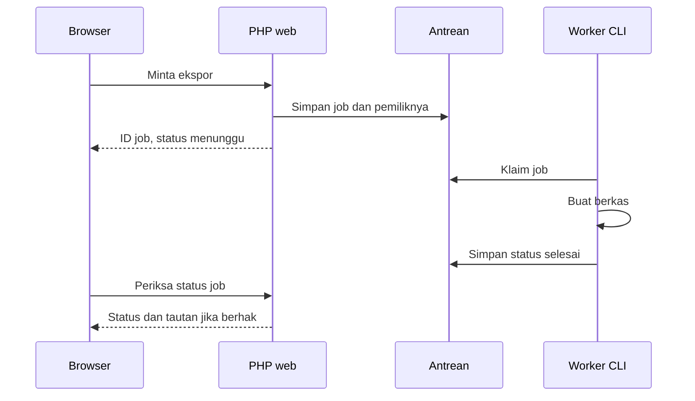

# Modul 5 — PHP Menengah sampai Mahir: Fungsi, OOP, dan Sync/Async

**Kelompok:** PHP & MySQL — RPL  
**Prasyarat:** [Modul 4](modul_4_php_mysql.md), array, percabangan, perulangan, PDO, CRUD dasar.  
**Lingkungan:** PHP 8.0+, XAMPP, VS Code. Contoh Fiber membutuhkan PHP 8.1+.  
**Alokasi:** 6 pertemuan × 3 JP; sesuaikan dengan kemampuan kelas.  
**Proyek:** `crud_siswa`. Latihan konsep disimpan terpisah di `latihan_php` agar tidak menimpa proyek sebelumnya.

> Modul ini membangun fondasi menuju tingkat mahir, bukan menjadikan pembaca mahir hanya dengan menyalin kode. Kemahiran memerlukan latihan, pengujian, membaca dokumentasi, dan perbaikan desain secara berulang.

## 1. Tujuan dan peta pembelajaran

Setelah selesai, peserta mampu:

1. Memisahkan fungsi pengolah data dari fungsi yang melakukan I/O.
2. Menggunakan type declaration, nullable type, closure, callback, dan variadic parameter.
3. Merancang objek dengan tanggung jawab jelas, bukan hanya memindahkan fungsi ke kelas.
4. Menjelaskan encapsulation, inheritance, abstraction, polymorphism, composition, dan dependency injection.
5. Menangani kegagalan dengan exception tanpa membocorkan detail internal ke pengguna.
6. Membedakan synchronous, asynchronous, concurrent, dan parallel.
7. Menjelaskan mengapa `fetch()` di browser tidak membuat query PDO menjadi asynchronous.
8. Menguji aturan bisnis tanpa memerlukan database.

| Pertemuan | Materi | Bukti hasil |
|---|---|---|
| 1 | Fungsi, tipe, scope, callback | Fungsi pengolah nilai dan uji batas |
| 2 | OOP dan invariant | Objek nilai yang tidak menerima keadaan tidak valid |
| 3 | Interface, composition, DI | Layanan rapor dengan repository pengganti |
| 4 | Exception, namespace, autoload | Struktur kelas yang dapat dipelihara |
| 5 | Sync/async, generator, Fiber, queue | Eksperimen waktu dan penjelasan alur |
| 6 | Pengujian dan refactoring | Mini tugas teruji dan presentasi desain |

## 2. Cara menjalankan latihan

Buat `C:\xampp\htdocs\latihan_php`. Setiap contoh berlabel **file lengkap** disimpan sebagai file berbeda. Contoh berlabel **potongan** hanya menjelaskan konsep dan tidak otomatis merupakan aplikasi lengkap.

Jalankan file CLI melalui terminal PowerShell:

```powershell
C:\xampp\php\php.exe C:\xampp\htdocs\latihan_php\fungsi.php
```

Untuk memeriksa sintaks tanpa mengeksekusi program:

```powershell
C:\xampp\php\php.exe -l C:\xampp\htdocs\latihan_php\fungsi.php
```

`php -l` tidak memeriksa apakah tabel tersedia, query benar, atau aturan bisnis sesuai. Karena itu pemeriksaan sintaks harus dilanjutkan pengujian perilaku.

## 3. Fungsi yang dapat digunakan ulang

### 3.1 Parameter, argumen, dan return

Parameter adalah nama penerima input pada deklarasi; argumen adalah nilai yang diberikan saat pemanggilan. `return` mengembalikan hasil dan menghentikan fungsi. `echo` menghasilkan output; keduanya tidak sama.

**File lengkap: `fungsi.php`**

```php
<?php
declare(strict_types=1);

function predikat(float $nilai, float $batasLulus = 75.0): string
{
    if (!is_finite($nilai) || $nilai < 0 || $nilai > 100) {
        throw new InvalidArgumentException('Nilai harus berada pada 0 sampai 100.');
    }
    if ($batasLulus < 0 || $batasLulus > 100) {
        throw new InvalidArgumentException('Batas kelulusan tidak valid.');
    }
    return $nilai >= $batasLulus ? 'Lulus' : 'Belum lulus';
}

echo predikat(80.0) . PHP_EOL;
echo predikat(70.0, 65.0) . PHP_EOL;
```

Hasilnya dua baris `Lulus`. Nilai default dipakai hanya jika argumen kedua tidak diberikan.

`strict_types=1` mengurangi konversi skalar otomatis untuk pemanggilan dari file tersebut. Ini bukan pengganti validasi HTTP: `$_POST` tetap perlu diperiksa karena dapat berisi string atau array. PHP masih menerima `int` untuk parameter `float`.

### 3.2 Nullable, union, dan tipe kembalian

| Bentuk | Makna | Kapan dipakai |
|---|---|---|
| `?string` | String atau `null` | Email opsional |
| `array|false` | Array atau `false` | Hasil `PDOStatement::fetch()` |
| `void` | Tidak mengembalikan nilai bermakna | Menulis log |
| `mixed` | Nilai dari tipe apa pun | Batas input yang belum dipercaya |
| `callable` | Sesuatu yang dapat dipanggil | Callback transformasi |

Jangan memakai `mixed` di seluruh program hanya agar error tipe hilang. Gunakan tipe yang lebih sempit setelah input dinormalisasi.

**Potongan: normalisasi input tanpa mengubah data asli.**

```php
function emailOpsional(mixed $input): ?string
{
    if (!is_string($input)) {
        throw new InvalidArgumentException('Email harus berupa teks.');
    }
    $email = trim($input);
    if ($email === '') {
        return null;
    }
    if (filter_var($email, FILTER_VALIDATE_EMAIL) === false) {
        throw new InvalidArgumentException('Format email tidak valid.');
    }
    return $email;
}
```

Input kosong menjadi `null`, bukan string kosong. Ini penting bagi kolom email `UNIQUE`: beberapa baris dapat memiliki `NULL`, tetapi nilai string kosong yang sama tetap dianggap duplikat.

### 3.3 Scope dan menghindari global

Variabel lokal hidup di dalam fungsi. Ketergantungan sebaiknya diberikan melalui parameter, bukan diambil diam-diam melalui `global`.

```php
function hitungDiskon(float $harga, float $persen): float
{
    return $harga * $persen / 100;
}
```

Fungsi di atas mudah diuji karena inputnya terlihat. Untuk uang sungguhan, pertimbangkan integer satuan terkecil atau pustaka desimal; floating point tidak mewakili semua pecahan secara tepat.

### 3.4 Pass-by-value, reference, dan efek samping

Secara umum parameter array diberikan dengan semantik nilai; PHP menggunakan optimasi copy-on-write. Parameter `&$data` mengizinkan perubahan variabel pemanggil. Gunakan reference hanya jika memang diperlukan dan dokumentasikan efeknya.

```php
function denganNamaBaru(array $siswa, string $nama): array
{
    $siswa['nama'] = trim($nama);
    return $siswa;
}
```

Objek berbeda: variabel menyimpan identitas objek. Dua variabel yang menunjuk objek yang sama melihat perubahan properti objek tersebut. `clone` membuat salinan dangkal; objek bersarang tidak otomatis disalin mendalam.

### 3.5 Variadic parameter dan unpacking

**File lengkap: `rata_rata.php`**

```php
<?php
declare(strict_types=1);

function rataRata(float ...$angka): ?float
{
    if ($angka === []) {
        return null;
    }
    return array_sum($angka) / count($angka);
}

$data = [80.0, 90.0, 100.0];
echo rataRata(...$data) . PHP_EOL;
var_dump(rataRata());
```

Hasil: `90` dan `NULL`. Nilai `null` berarti tidak ada data, bukan nilai nol. Operator `...` pada deklarasi mengumpulkan argumen; pada pemanggilan menyebarkan array menjadi argumen.

## 4. Closure, arrow function, dan higher-order function

Closure adalah fungsi tanpa nama yang dapat disimpan dalam variabel. Callback adalah fungsi yang diserahkan ke fungsi lain. Higher-order function menerima fungsi atau mengembalikan fungsi.

**File lengkap: `callback.php`**

```php
<?php
declare(strict_types=1);

$nilai = [60, 75, 90];
$batas = 75;

$lulus = array_filter($nilai, fn (int $n): bool => $n >= $batas);
$bonus = array_map(fn (int $n): int => min(100, $n + 5), $nilai);
$total = array_reduce($nilai, fn (int $jumlah, int $n): int => $jumlah + $n, 0);

$format = function (int $n) use ($batas): string {
    return $n . ($n >= $batas ? ' (lulus)' : ' (belum lulus)');
};

print_r(array_values($lulus));
print_r($bonus);
echo $total . PHP_EOL;
echo $format(90) . PHP_EOL;
```

Hasil yang perlu diperiksa:

- Nilai lulus: `75`, `90`.
- Nilai setelah bonus: `65`, `80`, `95`.
- Total: `225`.
- Format: `90 (lulus)`.

`array_filter()` mempertahankan key lama. Gunakan `array_values()` jika hasil akan menjadi daftar JSON agar indeks kembali berurutan. Arrow function menangkap variabel luar secara otomatis berdasarkan nilai. Closure biasa menggunakan `use`; `use (&$batas)` membuat reference dan sebaiknya dipakai dengan sadar.

Tidak semua `foreach` harus diganti callback. Pilih bentuk yang paling mudah dibaca oleh tim. Untuk alur dengan banyak kondisi dan penghentian awal, `foreach` sering lebih jelas.

## 5. OOP: menjaga data dan perilaku bersama

### 5.1 Encapsulation dan invariant

Invariant adalah aturan yang harus selalu benar selama objek digunakan. Contohnya nilai akademik harus berada pada rentang 0–100.

**File lengkap: `objek_nilai.php`**

```php
<?php
declare(strict_types=1);

final class NilaiAkademik
{
    private float $angka;

    public function __construct(float $angka)
    {
        if (!is_finite($angka) || $angka < 0 || $angka > 100) {
            throw new InvalidArgumentException('Nilai di luar rentang.');
        }
        $this->angka = $angka;
    }

    public function angka(): float
    {
        return $this->angka;
    }

    public function lulus(float $kkm = 75.0): bool
    {
        return $this->angka >= $kkm;
    }
}

$nilai = new NilaiAkademik(82.5);
echo $nilai->angka() . PHP_EOL;
echo $nilai->lulus() ? 'Lulus' : 'Belum lulus';
```

Properti `private` mencegah pemanggil menulis `$nilai->angka = -20`. Tidak ada setter karena contoh ini memakai objek yang tidak diubah setelah dibuat. Untuk mengganti nilai, buat objek baru. `final` menutup pewarisan; gunakan jika kelas tidak dirancang sebagai titik ekstensi.

### 5.2 Visibility

| Modifier | Dapat diakses dari | Saran |
|---|---|---|
| `public` | Pemanggil luar dan kelas | API yang memang diperlukan |
| `protected` | Kelas dan turunannya | Titik ekstensi yang disengaja |
| `private` | Kelas yang mendeklarasikan | Detail implementasi |

Semakin besar permukaan API publik, semakin banyak ketergantungan yang harus dijaga saat refactoring. Hindari menjadikan semua properti `public` hanya agar mudah diakses.

### 5.3 Abstraction dan inheritance

Modul 4 memakai kelas abstrak `Repository` dengan kontrak pencarian. Kelas abstrak dapat memiliki implementasi bersama sekaligus metode abstrak yang wajib diisi turunan. Inheritance cocok untuk hubungan **is-a** yang benar-benar dapat saling menggantikan.

Jangan membuat `NilaiRepository extends SiswaRepository` hanya karena keduanya memakai PDO: repository nilai bukan repository siswa. Lebih baik keduanya menerima PDO melalui constructor atau mewarisi abstraksi umum yang relevan.

### 5.4 Interface, polymorphism, composition, dan DI

**File lengkap: `layanan_rapor.php`**

```php
<?php
declare(strict_types=1);

interface SumberNilai
{
    public function untukSiswa(int $idSiswa): array;
}

final class SumberNilaiArray implements SumberNilai
{
    private array $data;

    public function __construct(array $data)
    {
        $this->data = $data;
    }

    public function untukSiswa(int $idSiswa): array
    {
        return $this->data[$idSiswa] ?? [];
    }
}

final class RaporService
{
    private SumberNilai $sumber;

    public function __construct(SumberNilai $sumber)
    {
        $this->sumber = $sumber;
    }

    public function rataRata(int $idSiswa): ?float
    {
        $nilai = $this->sumber->untukSiswa($idSiswa);
        return $nilai === [] ? null : array_sum($nilai) / count($nilai);
    }
}

$sumber = new SumberNilaiArray([1 => [80.0, 90.0], 2 => []]);
$layanan = new RaporService($sumber);
echo $layanan->rataRata(1) . PHP_EOL;
var_dump($layanan->rataRata(2));
```

Hasil: `85` dan `NULL`.

- **Interface:** menjelaskan apa yang dapat dilakukan sumber nilai.
- **Polymorphism:** service dapat memakai implementasi array maupun implementasi PDO dengan kontrak yang sama.
- **Composition:** service mempunyai sumber nilai, bukan mewarisi sumber nilai.
- **Dependency injection:** objek sumber diberikan dari luar melalui constructor.
- **Test double:** implementasi array memudahkan pengujian tanpa MySQL.

Kontrak juga mencakup makna data: array yang dikembalikan harus berisi angka nilai, bukan seluruh baris database. Tipe `array` sendiri belum menjamin bentuk elemen; dokumentasi dan pengujian tetap dibutuhkan.

### 5.5 SOLID dalam konteks kecil

| Prinsip | Penerapan praktis |
|---|---|
| Single responsibility | Repository menjalankan SQL, service menjalankan aturan bisnis, view menampilkan HTML |
| Open/closed | Tambahkan sumber nilai baru tanpa mengubah rumus service |
| Liskov substitution | Semua sumber nilai menjaga kontrak dan makna hasil |
| Interface segregation | Jangan mewajibkan sumber baca mengimplementasikan hapus atau ekspor |
| Dependency inversion | Service bergantung pada kontrak, bukan membuat koneksi PDO sendiri |

SOLID bukan kewajiban membuat banyak kelas. Untuk aplikasi kecil, fungsi sederhana dapat lebih tepat. Tambahkan abstraksi ketika ada tanggung jawab atau variasi yang nyata.

## 6. Exception dan penanganan kegagalan

Exception memisahkan alur berhasil dan gagal. Jangan menangkap semua kegagalan lalu mengembalikan array kosong, karena pengguna tidak dapat membedakan “tidak ada data” dengan “database mati”.

**File lengkap: `exception.php`**

```php
<?php
declare(strict_types=1);

function bagi(float $a, float $b): float
{
    if ($b === 0.0) {
        throw new InvalidArgumentException('Pembagi tidak boleh nol.');
    }
    return $a / $b;
}

try {
    echo bagi(10.0, 0.0);
} catch (InvalidArgumentException $e) {
    echo 'Input perlu diperbaiki: ' . $e->getMessage();
} finally {
    echo PHP_EOL . 'Percobaan selesai.';
}
```

Pada aplikasi web:

1. Validasi input dan tampilkan pesan yang dapat ditindaklanjuti.
2. Tangkap kegagalan database di batas controller.
3. Catat detail teknis melalui log server, bukan halaman publik.
4. Berikan status dan pesan umum jika terjadi kegagalan internal.
5. Jangan mencatat password, cookie session, atau token autentikasi.

`Throwable` mencakup `Exception` dan `Error`. Menangkap `Throwable` berguna pada batas aplikasi untuk respons umum, tetapi tidak boleh dijadikan alasan mengabaikan bug pemrograman.

## 7. Namespace dan autoload

Nama kelas global mudah bertabrakan saat proyek membesar. Namespace memisahkan identitas kelas; `use` memberikan nama singkat, bukan memuat file secara otomatis.

Contoh struktur lanjutan, **opsional dan tidak diwajibkan untuk Modul 6**:

```text
latihan_composer/
├── composer.json
├── src/
│   └── Domain/
│       └── Sapaan.php
└── demo.php
```

Isi `composer.json`:

```json
{
  "require": { "php": ">=8.0" },
  "autoload": { "psr-4": { "Sekolah\\": "src/" } }
}
```

Isi `src\Domain\Sapaan.php`:

```php
<?php
declare(strict_types=1);

namespace Sekolah\Domain;

final class Sapaan
{
    public function teks(string $nama): string
    {
        return 'Halo, ' . $nama;
    }
}
```

Isi `demo.php`:

```php
<?php
declare(strict_types=1);

require __DIR__ . '/vendor/autoload.php';

use Sekolah\Domain\Sapaan;

echo (new Sapaan())->teks('Rina');
```

Jika Composer sudah terpasang, jalankan dari folder latihan:

```powershell
composer dump-autoload
php demo.php
```

Hasil: `Halo, Rina`. Jika Composer belum tersedia, latihan inti tetap dapat dikerjakan memakai `require_once`. `__DIR__` merujuk direktori file saat ini, sehingga pemuatan tidak bergantung pada direktori terminal.

## 8. Synchronous, asynchronous, concurrent, dan parallel

### 8.1 Definisi yang tidak boleh tertukar

| Istilah | Arti | Contoh |
|---|---|---|
| Synchronous | Pemanggil menunggu operasi selesai sebelum melanjutkan alur tersebut | Query PDO biasa |
| Asynchronous | Operasi dapat selesai kemudian, hasil ditangani lewat mekanisme lanjutan | `fetch()` browser |
| Concurrent | Beberapa pekerjaan mengalami kemajuan dalam periode waktu yang tumpang tindih | Banyak request ditangani worker berbeda |
| Parallel | Pekerjaan benar-benar dieksekusi bersamaan | Proses pada beberapa inti CPU |
| Blocking | Eksekusi menunggu dan tidak melanjutkan pekerjaan lain pada jalur itu | `sleep()` atau I/O blocking |

PHP request-response biasa berjalan berurutan di dalam satu request. Web server dapat melayani beberapa request melalui beberapa worker, tetapi kapasitasnya bergantung konfigurasi. Ini tidak berarti setiap baris PHP berjalan paralel.

### 8.2 Eksperimen synchronous

**File lengkap: `sync.php`**, jalankan melalui CLI.

```php
<?php
$mulai = microtime(true);
sleep(1);
echo 'Pekerjaan A selesai' . PHP_EOL;
sleep(1);
echo 'Pekerjaan B selesai' . PHP_EOL;
printf('Durasi: %.2f detik%s', microtime(true) - $mulai, PHP_EOL);
```

Durasi mendekati dua detik, bukan satu detik. Waktu tepatnya bergantung penjadwalan sistem. `sleep()` hanya simulasi menunggu; bukan cara mempercepat program.

Untuk operasi berurutan:

$$T_{total} \approx T_A + T_B$$

Pada I/O yang benar-benar ditumpangtindihkan, durasi ideal mendekati operasi terlama ditambah overhead. Namun ketergantungan data, batas koneksi, dan operasi blocking dapat menghilangkan keuntungan itu.

### 8.3 Browser async, PHP tetap sync

Simpan dua file berikut di folder latihan web.

**File lengkap: `api_waktu.php`**

```php
<?php
header('Content-Type: application/json; charset=utf-8');
header('Cache-Control: no-store');
echo json_encode(['waktu' => date(DATE_ATOM)], JSON_THROW_ON_ERROR);
```

**File lengkap: `async.html`**

```html
<!doctype html>
<html lang="id">
<head><meta charset="utf-8"><title>Latihan async</title></head>
<body>
<button id="muat" type="button">Ambil waktu server</button>
<p id="hasil" aria-live="polite"></p>
<script>
const tombol = document.querySelector('#muat');
const hasil = document.querySelector('#hasil');
tombol.addEventListener('click', async () => {
    tombol.disabled = true;
    hasil.textContent = 'Memuat…';
    try {
        const respons = await fetch('api_waktu.php', { cache: 'no-store' });
        if (!respons.ok) throw new Error(`HTTP ${respons.status}`);
        const data = await respons.json();
        hasil.textContent = data.waktu;
    } catch (error) {
        hasil.textContent = 'Waktu server tidak dapat dimuat.';
        console.error(error);
    } finally {
        tombol.disabled = false;
    }
});
</script>
</body>
</html>
```

Buka melalui `http://localhost/latihan_php/async.html`, bukan `file://`.

Urutannya:

1. Event handler mengirim request.
2. `await` menunda kelanjutan fungsi async, tidak memblokir seluruh browser.
3. Server menjalankan PHP dan menghasilkan JSON.
4. Browser melanjutkan fungsi setelah respons diterima.
5. DOM diperbarui melalui `textContent`, bukan memasukkan HTML dari respons.

`fetch()` tetap resolve ketika server mengembalikan HTTP 404 atau 500; karena itu periksa `response.ok`. Pada aplikasi autentikasi, API sebaiknya mengirim JSON berstatus 401, bukan redirect ke HTML login yang kemudian gagal di-parse sebagai JSON.

### 8.4 Session lock

Handler session berbasis file biasanya mengunci session selama request. Dua request AJAX milik pengguna yang sama dapat saling menunggu meskipun browser mengirimkannya bersamaan.

Setelah selesai membaca/menulis session, endpoint read-only yang panjang dapat memanggil `session_write_close()`. Jangan melakukannya sebelum token atau waktu aktivitas selesai diperbarui. Setelah session ditutup, perubahan `$_SESSION` berikutnya tidak otomatis tersimpan.

### 8.5 Generator bukan async

**File lengkap: `generator.php`**

```php
<?php
function nomorUrut(int $jumlah): Generator
{
    for ($i = 1; $i <= $jumlah; $i++) {
        yield $i;
    }
}

foreach (nomorUrut(3) as $nomor) {
    echo $nomor . PHP_EOL;
}
```

Generator menghasilkan elemen satu per satu sehingga tidak harus membentuk array besar. `yield` tidak otomatis memindahkan pekerjaan ke thread lain atau membuat query database non-blocking. Jika generator membaca seluruh hasil melalui `fetchAll()` lebih dahulu, penghematan memori juga dapat hilang.

### 8.6 Fiber: kontrol penundaan, bukan mesin paralel

**File lengkap: `fiber.php` — hanya PHP 8.1+.**

```php
<?php
$fiber = new Fiber(function (): void {
    echo 'A' . PHP_EOL;
    $pesan = Fiber::suspend('berhenti sementara');
    echo $pesan . PHP_EOL;
});

echo $fiber->start() . PHP_EOL;
echo 'B' . PHP_EOL;
$fiber->resume('C');
```

Hasil berurutan: `A`, `berhenti sementara`, `B`, `C`. Program utama mengatur kapan Fiber dilanjutkan. Memanggil `sleep()` di dalam Fiber tetap memblokir thread yang menjalankannya. Untuk I/O async dibutuhkan scheduler/event loop dan driver I/O yang kompatibel, misalnya dalam ekosistem Amp atau ReactPHP. Keduanya tidak diperlukan untuk CRUD pada modul ini.

### 8.7 Queue untuk pekerjaan lama

Ekspor ribuan rapor atau pengiriman notifikasi massal lebih cocok dijalankan sebagai background job daripada menahan request pengguna terlalu lama.



Ini **rancangan konsep**, bukan queue siap pakai. Implementasi nyata membutuhkan klaim atomik, retry terbatas, timeout, idempotency, log, batas ukuran, dan otorisasi hasil. Retry dapat menjalankan job lebih dari sekali; jangan mengasumsikan setiap job selalu dieksekusi tepat sekali.

## 9. Pengujian aturan bisnis

Uji paling kecil memeriksa satu perilaku tanpa browser atau database. Gunakan pengecekan eksplisit; `assert()` dapat dinonaktifkan oleh konfigurasi PHP.

**File lengkap: `uji_rata_rata.php`**

```php
<?php
declare(strict_types=1);

function rataUji(array $nilai): ?float
{
    return $nilai === [] ? null : array_sum($nilai) / count($nilai);
}

function pastikan(bool $kondisi, string $pesan): void
{
    if (!$kondisi) {
        throw new RuntimeException($pesan);
    }
}

pastikan(rataUji([]) === null, 'Data kosong harus null.');
pastikan(abs(rataUji([80, 90]) - 85.0) < 0.00001, 'Rata-rata harus 85.');
pastikan(rataUji([0]) === 0.0, 'Nilai nol tidak boleh dianggap kosong.');
echo '3 pengujian lulus.' . PHP_EOL;
```

Perbandingan pecahan memakai toleransi. Lanjutkan dengan pengujian integrasi untuk repository MySQL, lalu pengujian HTTP untuk validasi, session, dan hak akses.

## 10. Latihan bertingkat dan pembahasan

### A. Dasar penguatan

1. Buat fungsi `maksimum(array $nilai): ?float` tanpa menganggap nol sebagai data kosong.
2. Buat callback yang mengambil nilai di bawah KKM.
3. Ubah closure agar KKM diberikan melalui parameter pembuat closure.

Pembahasan nomor 1: periksa `=== []`, lalu kembalikan `(float) max($nilai)`. Validasi elemen jika input berasal dari luar. Jangan memakai `empty($nilai[0])` karena nol adalah nilai sah.

### B. Menengah

1. Tambahkan implementasi PDO untuk `SumberNilai` dengan parameter ID siswa.
2. Query hanya `nilai_angka`, lalu ubah setiap hasil menjadi float.
3. Pastikan siswa tanpa nilai menghasilkan array kosong.
4. Gunakan implementasi tersebut dengan `RaporService` tanpa mengubah service.

Contoh inti query:

```sql
SELECT nilai_angka FROM nilai WHERE id_siswa = :id ORDER BY id_nilai;
```

Pembahasan: implementasi PDO bertanggung jawab memetakan baris database ke kontrak array angka. Service tidak mengetahui nama tabel atau placeholder SQL.

### C. Lanjutan

1. Ukur tiga request berurutan dengan `await` satu per satu.
2. Bandingkan dengan `Promise.all()` untuk tiga endpoint baca yang independen.
3. Jelaskan mengapa hasil waktu dapat tetap berurutan karena worker atau session lock.
4. Rancang job ekspor rapor dengan status `pending`, `running`, `done`, `failed`.

Tidak boleh menyimpulkan concurrency dari sintaks saja. Ukur, amati konfigurasi server, dan bedakan waktu browser dari waktu eksekusi server.

## 11. Kesalahan umum

| Gejala | Kemungkinan sebab | Perbaikan |
|---|---|---|
| `TypeError` pada input form | String/array HTTP diberikan langsung ke fungsi bertipe | Validasi bentuk, kemudian konversi |
| `Class not found` | File belum dimuat atau namespace salah | Periksa `require_once`, autoload, nama file |
| `Cannot redeclare` | Contoh terpisah digabung atau dimuat dua kali | Pisahkan latihan; gunakan `require_once` |
| `headers already sent` | Output muncul sebelum header/session | Jalankan bootstrap sebelum HTML |
| JSON menjadi object bukan list | Key hasil filter tidak berurutan | Gunakan `array_values()` |
| Async tidak lebih cepat | Operasi blocking, worker terbatas, session lock | Ukur dan periksa bottleneck |
| Error Fiber pada PHP 8.0 | Fitur belum tersedia | Lewati latihan Fiber atau gunakan PHP 8.1+ |

## 12. Penilaian dan daftar periksa

| Aspek | Bobot |
|---|---:|
| Ketepatan fungsi dan validasi | 25 |
| Desain OOP dan kontrak | 25 |
| Pemahaman sync/async | 20 |
| Pengujian batas dan kegagalan | 20 |
| Penjelasan dan kerapian | 10 |

- [ ] Dapat menjelaskan perbedaan `return` dan `echo`.
- [ ] Tidak mengandalkan variabel global untuk aturan bisnis.
- [ ] Dapat mengganti implementasi interface tanpa mengubah service.
- [ ] Memahami bahwa generator dan Fiber tidak otomatis membuat PDO async.
- [ ] Menguji data kosong, nol, batas nilai, dan input tidak valid.
- [ ] Siap melanjutkan ke [Modul 6 — Pengelolaan Data Sekolah](modul_6_php_mysql_data_sekolah.md).

## 13. Referensi

- [PHP: Functions](https://www.php.net/manual/en/language.functions.php)
- [PHP: Classes and Objects](https://www.php.net/manual/en/language.oop5.php)
- [PHP: Exceptions](https://www.php.net/manual/en/language.exceptions.php)
- [PHP: Generators](https://www.php.net/manual/en/language.generators.php)
- [PHP: Fibers](https://www.php.net/manual/en/language.fibers.php)
- [Composer: Autoload](https://getcomposer.org/doc/01-basic-usage.md#autoloading)
- [MDN: Fetch API](https://developer.mozilla.org/en-US/docs/Web/API/Fetch_API)
