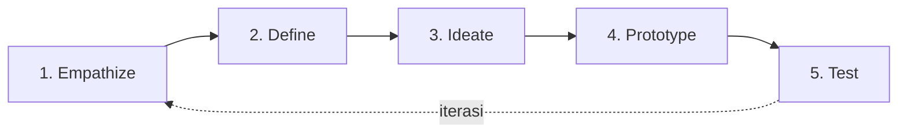
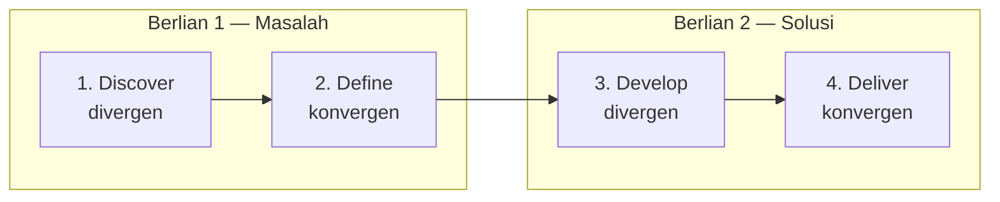
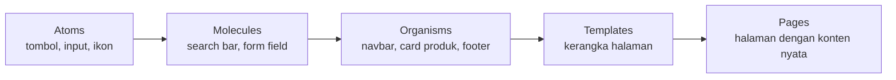

# Modul 1 — Pengantar UI/UX Design: Teori Lengkap dan Praktik Dasar

**Mata pelajaran:** UI/UX Design — Intro to UI/UX
**Alat:** Figma (akun gratis), FigJam, kertas dan pensil, browser
**Studi kasus:** Perancangan landing page produk minuman sehat
**Prasyarat:** Tidak ada — modul ini dirancang untuk pemula

---

## 1. Tujuan Pembelajaran

Setelah mempelajari modul ini, kamu mampu:

1. Menjelaskan pengertian UI (User Interface) dan UX (User Experience) serta perbedaan mendasarnya.
2. Menjelaskan mengapa UI/UX penting bagi produk digital dan bisnis.
3. Menyebutkan jalur karier di bidang UI/UX beserta tanggung jawabnya.
4. Menjelaskan kerangka kerja UX Design: Design Thinking dan Double Diamond, beserta perbedaannya.
5. Mengenal tools desain UI/UX dan alasan Figma menjadi standar industri.
6. Menerapkan prinsip dasar UI Design: Rule of 8, Auto Layout, Local Style, dan Design System.
7. Menjelaskan dan menerapkan enam hukum Gestalt dalam tata letak antarmuka.
8. Menyusun struktur landing page sederhana di Figma dengan alur kerja yang benar.

---

## 2. Bagian A — Apa itu UI/UX?

### 2.1 Definisi UI (User Interface)

**User Interface (UI)** adalah **segala sesuatu yang dilihat dan disentuh pengguna** saat berinteraksi dengan produk digital: tombol, warna, tipografi, ikon, gambar, jarak antar elemen, animasi, hingga tata letak halaman.

UI menjawab pertanyaan: **"Seperti apa tampilannya, dan bagaimana pengguna berinteraksi dengan elemen di layar?"**

Komponen utama UI:

| Komponen | Contoh | Peran |
| --- | --- | --- |
| **Layout** | Grid, susunan kolom, hierarki halaman | Mengatur posisi dan prioritas informasi |
| **Tipografi** | Jenis huruf, ukuran, ketebalan, jarak baris | Menentukan keterbacaan dan nada komunikasi |
| **Warna** | Palet primer, sekunder, netral, semantik | Membangun identitas merek dan memberi makna (merah = error) |
| **Komponen** | Tombol, form input, card, navbar, modal | Blok bangunan interaksi yang dipakai berulang |
| **Ikon & ilustrasi** | Ikon hamburger, ikon keranjang | Mempercepat pemahaman tanpa teks |
| **Spacing** | Margin, padding, gap | Memberi "ruang napas" agar tampilan tidak sesak |
| **Motion** | Transisi halaman, micro-interaction | Memberi umpan balik dan kesan hidup |

### 2.2 Definisi UX (User Experience)

**User Experience (UX)** adalah **keseluruhan pengalaman yang dirasakan pengguna** saat berinteraksi dengan produk — sebelum, selama, dan sesudah penggunaan. UX mencakup kemudahan, kecepatan, kejelasan, emosi, hingga kepuasan.

UX menjawab pertanyaan: **"Apakah pengguna bisa mencapai tujuannya dengan mudah, cepat, dan menyenangkan?"**

Menurut Peter Morville, UX yang baik memenuhi 7 aspek (**UX Honeycomb**):

| Aspek | Pertanyaan kunci |
| --- | --- |
| **Useful** | Apakah produk ini menyelesaikan masalah nyata pengguna? |
| **Usable** | Apakah mudah digunakan tanpa kebingungan? |
| **Desirable** | Apakah tampilannya menarik dan membangkitkan emosi positif? |
| **Findable** | Apakah informasi dan fitur mudah ditemukan? |
| **Accessible** | Apakah bisa digunakan oleh orang dengan keterbatasan (disabilitas)? |
| **Credible** | Apakah pengguna percaya pada produk ini? |
| **Valuable** | Apakah produk memberi nilai bagi pengguna dan bisnis? |

### 2.3 Perbedaan UI dan UX

Analogi klasik: **restoran**.

- **UX** adalah keseluruhan pengalaman makan: mudahnya reservasi, kecepatan pelayanan, rasa makanan, kenyamanan kursi, hingga proses pembayaran.
- **UI** adalah hal yang terlihat: desain menu, penataan piring, seragam pelayan, dekorasi ruangan.

| Aspek | UI | UX |
| --- | --- | --- |
| Fokus | Tampilan visual dan interaksi | Keseluruhan pengalaman dan alur |
| Pertanyaan | "Bagaimana tampilannya?" | "Bagaimana rasanya menggunakan ini?" |
| Output | Mockup, komponen, design system | Riset, persona, user flow, wireframe, prototype teruji |
| Keterampilan | Visual design, tipografi, warna | Riset pengguna, psikologi, arsitektur informasi |
| Diukur dengan | Konsistensi visual, estetika | Task success rate, waktu penyelesaian, kepuasan (SUS, NPS) |

> **Penting:** UI adalah *bagian dari* UX. UI yang indah tidak otomatis menghasilkan UX yang baik — aplikasi bisa cantik tapi membingungkan. Sebaliknya, UX yang baik hampir selalu membutuhkan UI yang jelas.

### 2.4 Mengapa UI/UX Penting?

**1. Dampak bisnis langsung.**
Penelitian Forrester menunjukkan setiap $1 yang diinvestasikan ke UX dapat mengembalikan hingga $100 (ROI 9.900%). Desain yang buruk membuat pengguna pergi: 88% pengguna enggan kembali ke situs setelah pengalaman buruk.

**2. First impression terbentuk sangat cepat.**
Pengguna membentuk penilaian terhadap sebuah situs dalam **± 50 milidetik** — sebagian besar penilaian itu berbasis visual (UI).

**3. Mengurangi biaya pengembangan.**
Memperbaiki masalah di tahap desain jauh lebih murah daripada setelah produk dirilis. Rasio biaya perbaikan bisa mencapai 1 : 10 : 100 (desain : development : setelah rilis).

**4. Meningkatkan konversi dan retensi.**
Alur checkout yang disederhanakan, form yang lebih pendek, dan CTA yang jelas terbukti menaikkan conversion rate secara signifikan.

**5. Aksesibilitas = jangkauan lebih luas.**
Sekitar 15% populasi dunia hidup dengan disabilitas. Desain yang aksesibel membuka pasar yang lebih besar sekaligus memenuhi regulasi di banyak negara.

### 2.5 Karier di Bidang UI/UX

| Peran | Tanggung jawab utama | Keterampilan kunci |
| --- | --- | --- |
| **UX Researcher** | Wawancara pengguna, usability testing, analisis data perilaku | Metodologi riset, empati, analisis |
| **UX Designer** | User flow, information architecture, wireframe, prototype | Problem solving, arsitektur informasi |
| **UI Designer** | Visual design, komponen, design system, mockup high-fidelity | Tipografi, warna, layout, Figma |
| **Product Designer** | Gabungan UX + UI + pemahaman bisnis, end-to-end | Semua di atas + product thinking |
| **UX Writer** | Microcopy: label tombol, pesan error, onboarding text | Menulis ringkas, memahami konteks |
| **Interaction Designer** | Animasi, transisi, micro-interaction | Motion design, prototyping lanjutan |
| **Design System Designer** | Membangun dan merawat pustaka komponen | Sistematisasi, dokumentasi, kolaborasi dengan engineer |

Jalur umum pemula: mulai sebagai **UI Designer** atau **UX Designer junior** → membangun portofolio studi kasus → berkembang menjadi Product Designer atau spesialis.

### 2.6 Tools UI/UX

| Kategori | Tools | Kegunaan |
| --- | --- | --- |
| Design & prototyping | **Figma**, Sketch, Adobe XD | Wireframe, mockup, prototype interaktif |
| Brainstorming & diagram | **FigJam**, Miro, Whimsical | User flow, mind map, workshop daring |
| Riset & testing | Maze, Lookback, Google Forms | Usability testing, survei |
| Handoff ke developer | Figma Dev Mode, Zeplin | Spesifikasi ukuran, warna, aset |
| Ilustrasi & aset | Adobe Illustrator, unDraw, Unsplash | Gambar dan ikon pendukung |

**Mengapa Figma menjadi standar industri?**

1. **Berbasis browser** — tidak perlu instalasi, berjalan di Windows/Mac/Linux.
2. **Kolaborasi real-time** — banyak orang mengedit satu file bersamaan, seperti Google Docs.
3. **Gratis untuk pemula** — plan free cukup untuk belajar dan portofolio.
4. **Figma Community** — ribuan template, UI kit, dan plugin gratis siap pakai.
5. **Satu ekosistem** — FigJam untuk brainstorming, Figma untuk desain, Dev Mode untuk handoff.

---

## 3. Bagian B — UX Design Process

### 3.1 Mengapa Butuh Proses?

Desain tanpa proses = menebak. Proses desain memastikan keputusan diambil **berdasarkan kebutuhan pengguna yang terverifikasi**, bukan selera pribadi desainer. Dua kerangka kerja paling populer: **Design Thinking** dan **Double Diamond**.

### 3.2 Design Thinking

Design Thinking (dipopulerkan Stanford d.school dan IDEO) adalah pendekatan pemecahan masalah yang **berpusat pada manusia** melalui 5 tahap:

| Tahap | Tujuan | Aktivitas umum | Output |
| --- | --- | --- | --- |
| **Empathize** | Memahami pengguna secara mendalam | Wawancara, observasi, survei, shadowing | Catatan riset, empathy map |
| **Define** | Merumuskan masalah inti | Sintesis data, affinity mapping | Problem statement, persona, "How Might We" |
| **Ideate** | Menghasilkan banyak ide solusi | Brainstorming, Crazy 8s, SCAMPER | Daftar ide terprioritas |
| **Prototype** | Mewujudkan ide dalam bentuk cepat & murah | Sketsa, wireframe, prototype klik | Prototype low/high fidelity |
| **Test** | Memvalidasi solusi dengan pengguna nyata | Usability testing, A/B test | Temuan, daftar perbaikan |

Sifat penting: **non-linear dan iteratif**. Hasil Test bisa mengembalikanmu ke Define atau Ideate — itu normal dan justru diharapkan.

Contoh **problem statement** yang baik (format: [pengguna] butuh [kebutuhan] karena [insight]):

> *"Ibu bekerja usia 25–40 tahun membutuhkan cara memesan makanan sehat dalam waktu kurang dari 2 menit, karena waktu istirahat mereka sangat terbatas."*

### 3.3 Double Diamond

Double Diamond (British Design Council, 2005) menggambarkan proses desain sebagai **dua berlian**: berlian pertama menemukan **masalah yang tepat**, berlian kedua menemukan **solusi yang tepat**. Masing-masing berlian terdiri dari fase **divergen** (melebar, mengeksplorasi) dan **konvergen** (menyempit, memutuskan).

| Fase | Pola pikir | Aktivitas | Output |
| --- | --- | --- | --- |
| **Discover** | Divergen: kumpulkan sebanyak mungkin insight | Riset pengguna, riset pasar, analisis kompetitor | Data mentah, temuan riset |
| **Define** | Konvergen: saring jadi satu masalah inti | Sintesis, prioritisasi | Design brief / problem statement |
| **Develop** | Divergen: eksplorasi banyak solusi | Ideasi, co-design, prototyping | Beberapa kandidat solusi |
| **Deliver** | Konvergen: uji, pilih, dan luncurkan | Testing, refinement, rilis | Produk final |

### 3.4 Perbedaan Design Thinking vs Double Diamond

| Aspek | Design Thinking | Double Diamond |
| --- | --- | --- |
| Jumlah tahap | 5 (Empathize–Test) | 4 (Discover–Deliver) |
| Penekanan | Empati & iterasi cepat | Pola pikir divergen–konvergen yang eksplisit |
| Bentuk visual | Siklus/lingkaran berulang | Dua berlian berurutan |
| Kekuatan | Cocok untuk inovasi & masalah ambigu | Cocok untuk menstrukturkan proyek dari brief ke rilis |
| Asal | Stanford d.school / IDEO | British Design Council |

Keduanya **tidak saling bertentangan** — Empathize+Define ≈ Berlian 1, Ideate+Prototype+Test ≈ Berlian 2. Pilih yang paling sesuai budaya tim; banyak tim menggabungkan keduanya.

### 3.5 Studi Kasus Singkat: Design Thinking

**Kasus:** Aplikasi kantin sekolah — antrean terlalu panjang saat istirahat.

1. **Empathize:** Wawancara 10 siswa; temuan: waktu istirahat 20 menit, antre bisa 12 menit.
2. **Define:** *"Siswa butuh cara memesan makanan sebelum jam istirahat agar sisa waktunya cukup untuk makan."*
3. **Ideate:** Pre-order via aplikasi, loket khusus pesanan online, sistem nomor antrean digital.
4. **Prototype:** Wireframe alur pre-order 3 layar di Figma.
5. **Test:** 5 siswa mencoba prototype; 4 berhasil memesan < 1 menit; perbaiki label tombol yang membingungkan.

### 3.6 Studi Kasus Singkat: Double Diamond

**Kasus:** Website donasi yayasan — banyak pengunjung tapi sedikit yang menyelesaikan donasi.

1. **Discover:** Analitik menunjukkan 70% pengguna berhenti di halaman form; wawancara mengungkap form terasa terlalu panjang dan metode bayar terbatas.
2. **Define:** *"Donatur membutuhkan proses donasi maksimal 3 langkah dengan metode pembayaran populer."*
3. **Develop:** Eksplorasi 3 konsep: form satu halaman, wizard 3 langkah, quick-donate dengan nominal preset.
4. **Deliver:** Uji ketiganya; wizard 3 langkah + nominal preset menang; rilis bertahap dan pantau conversion.

---

## 4. Bagian C — Teori UI Design

### 4.1 Tahapan UI Design (The Stage of UI Design)

| Tahap | Fidelity | Isi | Tujuan |
| --- | --- | --- | --- |
| **1. Sketch** | Sangat rendah | Coretan tangan di kertas | Eksplorasi cepat banyak alternatif layout |
| **2. Wireframe** | Rendah | Kotak abu-abu, placeholder teks, tanpa warna | Memvalidasi struktur & hierarki konten |
| **3. Mockup** | Tinggi | Warna, tipografi, gambar asli | Memvalidasi visual design final |
| **4. Prototype** | Tinggi + interaktif | Mockup yang bisa diklik antarlayar | Menguji alur dengan pengguna |

**Aturan emas:** jangan lompat ke mockup sebelum struktur wireframe disepakati. Merevisi kotak abu-abu jauh lebih murah daripada merevisi desain berwarna penuh.

### 4.2 Rule of 8 (8-Point Grid)

**Rule of 8** adalah sistem spacing di mana **semua ukuran dan jarak merupakan kelipatan 8** (8, 16, 24, 32, 40, 48, 64…).

Mengapa 8?

1. **Konsistensi otomatis** — desainer tidak lagi menebak "jarak ini 13px atau 15px?"
2. **Cocok dengan resolusi layar** — mayoritas ukuran layar habis dibagi 8, sehingga elemen tidak jatuh di setengah piksel (blur).
3. **Komunikasi mudah dengan developer** — spacing bisa dipetakan ke token: `space-1 = 8px`, `space-2 = 16px`, dst.
4. **Skala yang cukup renggang** — perbedaan antar langkah terlihat jelas oleh mata.

Penerapan praktis:

| Elemen | Nilai umum |
| --- | --- |
| Padding dalam tombol | 8–16 px vertikal, 16–24 px horizontal |
| Jarak antar elemen dalam satu grup | 8 atau 16 px |
| Jarak antar grup/section | 32, 48, 64, atau 80 px |
| Tinggi tombol | 40 atau 48 px |
| Ukuran ikon | 16, 24, atau 32 px |

> Pengecualian: tipografi kadang memakai **kelipatan 4** (half-step) untuk ukuran seperti 12, 14, 20 px — ini masih dianggap bagian dari sistem yang sama.

### 4.3 Auto Layout

**Auto Layout** adalah fitur Figma yang membuat frame **menyesuaikan ukurannya secara otomatis** terhadap isinya — mirip konsep *flexbox* di CSS.

Properti utama:

| Properti | Fungsi | Padanan CSS |
| --- | --- | --- |
| Direction | Susun anak ke bawah / ke samping | `flex-direction` |
| Gap (spacing between items) | Jarak antar anak | `gap` |
| Padding | Ruang dalam frame | `padding` |
| Alignment | Posisi anak di dalam frame | `justify-content`, `align-items` |
| Resizing: **Hug** | Frame mengikuti ukuran isi | `width: fit-content` |
| Resizing: **Fill** | Anak mengisi ruang tersedia | `flex: 1` |
| Resizing: **Fixed** | Ukuran tetap | `width: 200px` |

Manfaat: tombol otomatis melebar saat teks berubah, card otomatis meninggi saat konten bertambah, dan seluruh layout tetap rapi saat direvisi. **Biasakan semua frame memakai Auto Layout** — ini keterampilan Figma paling penting setelah menggambar bentuk dasar.

### 4.4 Local Style dan Variables

**Local Style** adalah definisi terpusat untuk warna, teks, dan efek yang bisa dipakai ulang di seluruh file. Ubah sekali → semua pemakaiannya ikut berubah.

Struktur minimal untuk satu proyek:

**Color styles:**

| Nama | Contoh nilai | Kegunaan |
| --- | --- | --- |
| `Primary/500` | #16A34A | Warna utama merek, CTA |
| `Primary/100` | #DCFCE7 | Latar lembut, hover |
| `Neutral/900` | #171717 | Teks utama |
| `Neutral/500` | #737373 | Teks sekunder |
| `Neutral/100` | #F5F5F5 | Latar section |
| `Semantic/Error` | #DC2626 | Pesan kesalahan |

**Text styles:**

| Nama | Spesifikasi |
| --- | --- |
| `Heading/H1` | 48–56 px, Bold, line-height 1.1 |
| `Heading/H2` | 32–40 px, Bold, line-height 1.2 |
| `Heading/H3` | 24 px, SemiBold |
| `Body/Large` | 18 px, Regular, line-height 1.6 |
| `Body/Base` | 16 px, Regular, line-height 1.5 |
| `Caption` | 12–14 px, Regular |

### 4.5 Design System

**Design System** adalah kumpulan komponen, style, aturan, dan dokumentasi yang menjadi **satu sumber kebenaran** untuk seluruh produk.

Hierarki umum (Atomic Design — Brad Frost):

Design system terkenal untuk dipelajari (tersedia di Figma Community):

| Design System | Pemilik | Ciri khas |
| --- | --- | --- |
| **Material Design 3** | Google | Dokumentasi paling lengkap, komponen Android/Web |
| **Human Interface Guidelines** | Apple | Standar iOS/macOS |
| **Ant Design** | Alibaba | Komponen dashboard/admin yang kaya |
| **Polaris** | Shopify | Fokus e-commerce |
| **Carbon** | IBM | Enterprise, aksesibilitas kuat |

**Cara belajar dari design system:** duplikasi file-nya dari Figma Community, bongkar satu komponen (misal tombol), amati bagaimana mereka menamai style, mengatur Auto Layout, dan mendefinisikan state (default, hover, disabled).

### 4.6 Plugin untuk Desainer Efisien

| Plugin | Fungsi |
| --- | --- |
| **Unsplash** | Sisipkan foto stok gratis langsung ke desain |
| **Iconify** | Ribuan ikon open-source (Material, Tabler, Lucide) |
| **Content Reel** | Isi data dummy: nama, avatar, alamat |
| **Stark** | Cek kontras warna & aksesibilitas |
| **Autoflow** | Gambar panah alur antar layar |
| **Lorem Ipsum** | Teks placeholder |

---

## 5. Bagian D — Gestalt Principle

### 5.1 Latar Belakang

**Prinsip Gestalt** berasal dari psikologi Jerman awal abad ke-20 (Wertheimer, Köhler, Koffka). Inti teorinya: **otak manusia secara otomatis mengorganisasi elemen visual menjadi kelompok dan pola yang bermakna** — "keseluruhan berbeda dari sekadar jumlah bagian-bagiannya."

Bagi desainer UI, Gestalt menjelaskan **mengapa** suatu layout terasa rapi atau berantakan, dan memberi aturan yang bisa langsung diterapkan.

### 5.2 Law of Proximity (Kedekatan)

> Elemen yang **berdekatan** dipersepsikan sebagai satu kelompok.

- Label form harus lebih dekat ke input miliknya daripada ke input lain.
- Jarak **antar section** harus lebih besar daripada jarak **di dalam section** (misal: dalam card 8–16 px, antar card 24–32 px, antar section 64–80 px).
- Kesalahan umum: spacing seragam di mana-mana → pengguna tidak bisa membedakan grup.

### 5.3 Law of Similarity (Kesamaan)

> Elemen yang **mirip** (warna, bentuk, ukuran) dipersepsikan memiliki fungsi yang sama.

- Semua link memakai warna dan gaya yang sama → pengguna langsung tahu mana yang bisa diklik.
- Semua tombol primer memakai satu warna; tombol sekunder gaya berbeda yang konsisten.
- Konsekuensi: jika elemen **bukan** tombol tapi terlihat seperti tombol, pengguna akan mencoba mengkliknya (false affordance).

### 5.4 Law of Continuation (Keberlanjutan)

> Mata mengikuti **garis atau kurva** dan menganggap elemen di sepanjang garis itu berhubungan.

- Elemen yang disejajarkan pada satu garis (alignment) terasa sebagai satu rangkaian.
- Carousel yang menampilkan sebagian item berikutnya di tepi layar memberi sinyal "masih ada lagi, geser ke kanan".
- Grid yang rapi memanfaatkan hukum ini: mata mengalir mulus mengikuti kolom dan baris.

### 5.5 Law of Common Region (Wilayah Bersama)

> Elemen di dalam **batas yang sama** (garis, latar, kartu) dipersepsikan satu kelompok — bahkan lebih kuat daripada proximity.

- **Card** adalah penerapan paling umum: gambar + judul + harga + tombol dalam satu kotak berlatar putih dan ber-shadow jelas milik satu produk.
- Section dengan warna latar berbeda otomatis memisahkan konten.
- Gunakan secukupnya: terlalu banyak kotak-dalam-kotak membuat tampilan berat.

### 5.6 Law of Common Fate (Nasib Bersama)

> Elemen yang **bergerak bersama ke arah yang sama** dipersepsikan satu kelompok.

- Dropdown menu: semua item muncul serempak dari satu titik → terasa satu kesatuan.
- Item carousel yang bergeser bersamaan.
- Micro-interaction: saat satu card di-hover dan seluruh isinya ikut naik sedikit, isinya terasa satu unit.

### 5.7 Law of Figure-Ground (Figur dan Latar)

> Otak otomatis memisahkan objek **utama (figure)** dari **latar belakang (ground)**.

- **Modal/dialog**: latar digelapkan (overlay) agar modal menjadi figure yang jelas.
- Teks di atas foto butuh overlay gelap/terang agar tetap terbaca (kontras figure vs ground).
- Hero section: produk/ilustrasi menonjol karena latar dibuat sederhana.

### 5.8 Ringkasan Penerapan Gestalt

| Hukum | Alat desain yang digunakan | Contoh di landing page |
| --- | --- | --- |
| Proximity | Spacing | Jarak antar section > jarak dalam section |
| Similarity | Warna, bentuk, ukuran konsisten | Semua CTA hijau, semua card seragam |
| Continuation | Alignment, grid | Produk tersusun dalam grid rapi |
| Common Region | Card, latar section | Testimoni dalam card terpisah |
| Common Fate | Animasi, transisi | Item menu muncul serempak |
| Figure-Ground | Kontras, overlay | Teks hero di atas foto ber-overlay |

---

## 6. Bagian E — Teori Landing Page

### 6.1 Apa itu Landing Page?

**Landing page** adalah halaman web yang dirancang dengan **satu tujuan konversi spesifik**: membeli, mendaftar, mengunduh, atau menghubungi. Berbeda dengan homepage yang punya banyak tujuan, landing page memfokuskan semua elemen ke **satu Call-to-Action (CTA)**.

### 6.2 Anatomi Landing Page

Urutan section mengikuti pola persuasi **AIDA** (Attention → Interest → Desire → Action):

| # | Section | Isi | Peran AIDA |
| --- | --- | --- | --- |
| 1 | **Hero** | Headline, subheadline, CTA utama, visual produk | Attention |
| 2 | **Key Ingredients / Features** | 3–4 keunggulan utama dengan ikon | Interest |
| 3 | **Product List** | Grid produk/varian dengan harga | Interest |
| 4 | **Review / Testimonial** | Kutipan pelanggan, rating, foto | Desire (social proof) |
| 5 | **Promotion & Subscribe** | Diskon, form email | Action |
| 6 | **Footer** | Navigasi, kontak, sosial media, legal | Pendukung |

### 6.3 Prinsip Hero yang Efektif

1. **Headline** menjawab "apa manfaatnya untukku?" dalam < 10 kata — bukan nama produk, tapi nilai bagi pengguna.
2. **Subheadline** 1–2 kalimat menjelaskan cara produk memberikan manfaat itu.
3. **Satu CTA primer** yang kontras — hindari dua tombol sama kuat.
4. **Visual** mendukung pesan, bukan sekadar dekorasi.
5. Semua elemen penting terlihat **tanpa scroll** (above the fold) pada resolusi umum (1440×900 / 1920×1080).

### 6.4 Visual Hierarchy

Pengguna tidak membaca — mereka **memindai (scan)**. Kendalikan urutan pandangan dengan:

| Alat | Cara kerja |
| --- | --- |
| **Ukuran** | Elemen terbesar dilihat pertama (headline > subheadline > body) |
| **Kontras warna** | CTA berwarna mencolok di antara elemen netral |
| **Whitespace** | Ruang kosong di sekitar elemen membuatnya menonjol |
| **Posisi** | Pola scan F atau Z; sudut kiri-atas dilihat pertama |
| **Ketebalan** | Bold menarik mata lebih dulu daripada regular |

### 6.5 Menggunakan AI untuk Brainstorming

AI (ChatGPT, Copilot, dsb.) berguna di fase ideasi — **bukan pengganti proses desain**:

- Minta 10 alternatif headline untuk produk X, lalu kurasi.
- Minta struktur section landing page untuk industri tertentu.
- Minta persona pengguna awal sebagai hipotesis (tetap wajib divalidasi riset nyata).
- Minta copy placeholder yang realistis untuk mockup.

Contoh prompt: *"Buatkan 10 headline landing page untuk minuman jus sehat cold-pressed, target ibu muda urban, nada hangat, maksimal 8 kata."*

---

## 7. Praktik Terarah: Landing Page "FreshSip" di Figma

> Bagian ini adalah **arahan ringkas** — kerjakan sambil membuka Figma. Studi kasus: **FreshSip**, merek jus cold-pressed.

### Langkah 0 — Persiapan (±15 menit)

1. Buat akun di [figma.com](https://figma.com), buat file baru bernama `FreshSip Landing Page`.
2. Pelajari shortcut dasar: `F` (frame), `R` (rectangle), `T` (text), `Shift+A` (Auto Layout), `Ctrl+D` (duplicate).
3. Buat frame **Desktop 1440 × ±4000 px** sebagai kanvas halaman.

### Langkah 1 — Siapkan Local Style (±20 menit)

1. Buat color styles sesuai tabel di §4.4 (ganti Primary dengan hijau segar, misal `#16A34A`).
2. Buat text styles H1–H3, Body, Caption dengan font **Poppins** (heading) dan **Inter** (body) dari Google Fonts bawaan Figma.
3. Uji: buat satu teks, terapkan style, lalu ubah definisi style — pastikan teks ikut berubah.

### Langkah 2 — Wireframe Dulu (±30 menit)

1. Di halaman terpisah, susun 6 section (Hero → Footer) sebagai **kotak abu-abu berlabel** saja.
2. Terapkan Rule of 8: jarak antar section 80 px, padding kiri-kanan konten 120 px (container ±1200 px).
3. Review sendiri dengan daftar Gestalt §5.8 sebelum lanjut.

### Langkah 3 — Hero (±45 menit)

1. Frame section tinggi ±720 px, Auto Layout horizontal: kolom teks (kiri) + visual produk (kanan).
2. Kolom teks: H1 headline, Body/Large subheadline, tombol CTA `Order Now` (tinggi 48 px, padding 16/32, warna Primary) — semuanya dalam Auto Layout vertikal gap 24.
3. Visual: foto botol jus dari plugin **Unsplash** dengan latar lembut `Primary/100`.
4. Cek: hierarchy jelas? CTA paling kontras? (lihat §6.3–6.4).

### Langkah 4 — Key Ingredients (±30 menit)

1. Judul section (H2) + 4 card sejajar (Auto Layout horizontal, gap 24).
2. Tiap card: ikon (plugin **Iconify**) + judul H3 + deskripsi 1 kalimat, Auto Layout vertikal gap 16, padding 24, corner radius 16.
3. Buat 1 card → jadikan **Component** (`Ctrl+Alt+K`) → duplikasi 3 instance → ganti isinya.

### Langkah 5 — Product List (±30 menit)

1. Grid 3–4 card produk: foto, nama, harga, tombol kecil `Add`.
2. Terapkan **Law of Similarity**: semua card identik strukturnya; dan **Continuation**: sejajar rapi di grid.

### Langkah 6 — Review, Promo, Footer (±45 menit)

1. **Review:** 3 card testimoni (foto via **Content Reel**, nama, rating bintang, kutipan) di atas latar `Neutral/100` (Common Region).
2. **Promotion & Subscribe:** banner latar Primary, teks promo + input email + tombol dalam satu Auto Layout.
3. **Footer:** latar `Neutral/900`, teks putih; 3–4 kolom link + sosial media + copyright.

### Langkah 7 — Review Akhir (±20 menit)

Periksa dengan checklist:

- [ ] Semua spacing kelipatan 8?
- [ ] Semua warna & teks memakai Local Style (tidak ada warna "liar")?
- [ ] Semua frame memakai Auto Layout?
- [ ] Hanya ada satu CTA primer per layar?
- [ ] Enam hukum Gestalt bisa kamu tunjukkan masing-masing minimal satu contohnya?
- [ ] Zoom out 25% — hierarki masih terbaca? (squint test)

---

## 8. Latihan Mandiri

1. **Teori:** Jelaskan dengan kata-katamu sendiri perbedaan UI dan UX, beserta satu contoh produk yang UI-nya bagus tapi UX-nya buruk (atau sebaliknya).
2. **Analisis:** Buka satu aplikasi favoritmu, temukan dan tangkap-layar penerapan 3 hukum Gestalt yang berbeda, lalu beri anotasi.
3. **Proses:** Pilih satu masalah di sekitarmu (sekolah/kampus/rumah), jalankan Design Thinking sampai tahap Define — hasilkan satu problem statement.
4. **Praktik:** Selesaikan landing page FreshSip, lalu buat versi **mobile 375 px** dari section Hero saja dengan menyusun ulang Auto Layout menjadi vertikal.
5. **Eksplorasi:** Duplikasi file Material Design 3 dari Figma Community, bongkar komponen Button, dan catat 3 hal yang bisa kamu tiru.

---

## 9. Rangkuman

- **UI** = tampilan dan interaksi; **UX** = keseluruhan pengalaman. UI adalah bagian dari UX.
- UI/UX penting karena berdampak langsung pada konversi, retensi, biaya pengembangan, dan kepercayaan pengguna.
- **Design Thinking** (5 tahap, iteratif, berbasis empati) dan **Double Diamond** (4 fase, divergen–konvergen) adalah dua kerangka proses yang saling melengkapi.
- **Figma** jadi standar karena berbasis browser, kolaboratif, gratis, dan punya ekosistem Community + plugin.
- Fondasi UI Design: **tahapan sketch→wireframe→mockup→prototype**, **Rule of 8**, **Auto Layout**, **Local Style**, dan belajar dari **Design System** besar.
- **Enam hukum Gestalt** (Proximity, Similarity, Continuation, Common Region, Common Fate, Figure-Ground) adalah dasar ilmiah mengapa layout terasa rapi.
- **Landing page** efektif mengikuti pola AIDA dengan satu CTA yang jelas dan visual hierarchy yang terkendali.

## 10. Referensi Belajar Lanjutan

- Figma Learn — [help.figma.com](https://help.figma.com) (dokumentasi resmi + tutorial)
- Laws of UX — [lawsofux.com](https://lawsofux.com) (prinsip psikologi desain, termasuk Gestalt)
- Nielsen Norman Group — [nngroup.com](https://www.nngroup.com) (artikel riset UX)
- Material Design 3 — [m3.material.io](https://m3.material.io)
- Refactoring UI (Adam Wathan & Steve Schoger) — buku praktis visual design untuk non-desainer
